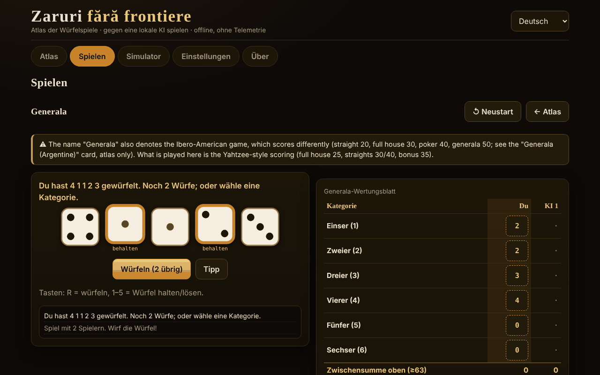

# Zaruri fără frontiere

[English](README.md) · [Română](README.ro.md) · [Français](README.fr.md) · [Italiano](README.it.md) · [Español](README.es.md) · [Português](README.pt.md) · **Deutsch** · [Magyar](README.hu.md)

**Version:** 1.2.9 · **Zuletzt aktualisiert:** 2026-10-26

Oberflächensprachen: **Română, English, Français, Italiano, Español, Português (PT), Deutsch, Magyar**

Ein Atlas von Würfelspielen und Partien gegen eine lokale KI — eine einzige HTML-Datei, offline, ohne Abhängigkeiten und ohne Telemetrie.

**Online:** https://chiuta.github.io/Zaruri-fara-frontiere/

## Was es ist

Ein Atlas mit 26 Würfelspiel-Steckbriefen, von denen **12 spielbar** sind gegen eine lokale KI (eine didaktische Engine, kein Sprachmodell) und 14 **nur im Atlas** stehen (beschrieben, nicht implementiert). Dazu ein generischer Würfelsimulator. Alles läuft im Browser, aus einer einzigen `index.html`.

Dies ist **keine Glücksspiel-App um echtes Geld**: Es gibt keine echten Einsätze, Einzahlungen oder Gewinne. Craps verwendet nur virtuelle Chips.

## Funktionen (im Code und in Tests geprüft)

- **Würfel**: `crypto.getRandomValues` mit *Rejection Sampling* (ohne Modulo-Verzerrung). Optional ein *Seed* (mulberry32) für reproduzierbare Partien — dann sind die Würfel vorhersehbar, und die App weist darauf hin.
- **Große SVG-Würfel**, mit Augen und einem `aria-label` mit dem Wert; die Wurfanimation beachtet `prefers-reduced-motion` und einen Schalter in den Einstellungen.
- **Oberfläche in 8 Sprachen** (RO/EN/FR/IT/ES/PT/DE/HU) mit Umschalter und Autoerkennung aus `navigator.languages`; `lang` wird dynamisch aktualisiert.
- **Tastatur**: Alle Aktionen haben Schaltflächen, die mit Tab/Enter/Leertaste erreichbar sind; Kürzel für Würfel (R = würfeln, 1–5 = behalten), wo anwendbar; Touch-Flächen ≥ 44 px; sichtbarer Fokus; `aria-live`-Meldungen; Layout ohne horizontales Scrollen bei 390 px.
- **Lokale Statistiken** (Siege/Niederlagen/Unentschieden) in `localStorage`, nur wenn verfügbar; sie lassen sich in den Einstellungen löschen.
- **Simulator**: Notation `NdM`, `+/−`, Konstanten (bis 1 000 000 000), `d%`, höchste/niedrigste behalten/verwerfen (`kh/kl/dh/dl`), Grenzen von 100 Würfeln / 1000 Seiten / 12 Termen, Verlauf (die letzten 50 Würfe, lokal gespeichert). Die exakte Verteilung wird nur für Ausdrücke mit einem Wertebereich ≤ 400 Werten und geringem Aufwand berechnet (sonst erscheint ein Hinweis, der Tab wird nicht blockiert).
- **Analyse im Simulator** (Ausdrücke mit exakter Verteilung): Wahrscheinlichkeitsabfrage `P(S ≥ / ≤ / = v)`, berechnet aus der exakten Verteilung (mit einem ungefähren Verhältnis 1 : x); Schaltfläche „10 000 Würfe simulieren", die den beobachteten Mittelwert und die Häufigkeiten mit den exakten vergleicht; „Verlauf kopieren".
- Korrekte **Pluralbildung** in Meldungen mit Zahlen (z. B. „1 Wurf" / „2 Würfe") in den 8 Sprachen.

## Varianten

| Variante | Spielbar? | ⚠ Näherungen / was fehlt |
|---|---|---|
| Generala (Regeln vom Typ „Yahtzee®", eine Marke von Hasbro) | ja, 2–4 Spieler | ⚠ Der Name „Generala" bezeichnet auch das iberoamerikanische Spiel mit anderer Wertung (Straße 20, Full House 30, Poker 40, Generala 50; eigener Steckbrief, nur im Atlas). Hier: Wertung vom Yahtzee-Typ, Bonus 35 ab ≥ 63, Bonus 100 nur wenn „Generala" = 50, offizielle Jokerregel (erzwungen). Keine regionalen Varianten. |
| 10000 (Farkle) | ja, 2–4 | Es gibt keine kanonischen Regeln: Voreinstellung „klassisch" (nur 1er, 5er, Drilling; 4/5/6 Gleiche verdoppeln), konfigurierbare Einstiegsschwelle und Zielpunktzahl, optionale Schlussrunde. |
| Greed (Variante) | ja | Nur die Voreinstellung „Kombinationen" (Straße 1–6 und drei Paare = 1500); das ist KEINE kanonische „Greed"-Regel. |
| Perudo (Lügenwürfel) | ja, 2–5 | Dokumentierte Entscheidungen: Palifico nur ab ≥ 3 Spielern, Calza erlaubt, Rundeneröffnung mit 1ern (Jokern) verboten (außer Palifico oder bei nur einem Würfel), der Verlierer eröffnet die nächste Runde (nach einer „Calza" eröffnet, wer sie angesagt hat). |
| Lügenwürfel (klassisch) | ja, 2–5 | Die minimale Variante: ohne Joker, ohne Calza, ohne Palifico. |
| Mia (Meyer) | ja, 2–4 | Hausregeln variieren; die Variante „du gibst den ungesehenen Becher weiter" ist NICHT implementiert; streng steigende Ansagen; eine zu Recht angezweifelte Mia kostet 2 Leben. |
| Craps | ja, 1 Spieler | Pass / Don't Pass / Come / Don't Come und Odds zu echten Quoten (Limits 1×, 2×, 3×, 5×, 10×, 3-4-5×). NICHT: Place, Field, Hardways, Proposition-Wetten; Wetten lassen sich nicht zurücknehmen; Come-Odds sind beim Come-out aus; 12 = Push bei Don't. |
| Pig | ja | — (optimale KI lokal berechnet, Pig bis 100) |
| Big Pig | ja | Variante: eine einzelne 1 = Runde verloren; Doppel-1 = 25; andere Pasche = doppelte Summe. Es gibt keine kanonische Variante. |
| Chicago | ja, 2–4 | Nur die einfache Variante (11 Runden, Ziel 2–12); keine Versionen mit Einsätzen. Reines Glücksspiel. |
| Shut the box | ja, du gegen die KI | Eine Runde = ein Zug; 3/5/7 Runden, die verbleibenden Plättchen werden addiert; die „Ein-Würfel"-Regel optional/verpflichtend/nie. |
| Pokerwürfel | ja, du gegen die KI | Blätter 9–A, bis zu 3 Würfe; Stichentscheid nach Art, dann nach den Augen der Gruppen; gleich = Unentschieden. |
| Argentinische Generala, Yacht, Yatzy | nur im Atlas | Werte nicht eindeutig belegt; die Regeln variieren. |
| Hazard, Sic Bo, Cee-lo, Ship-Captain-Crew, Crown & Anchor, Bunco, Barbut, Skunk, Pass the Pigs, nichttransitive Würfel, Rollenspielwürfel | nur im Atlas | Zusammenfassungen; „Pass the Pigs" lässt sich ohne gemessene Wahrscheinlichkeiten nicht simulieren; Barbut hat unsichere Regeln. |

## KI — was sie ist und was nicht

Sie ist kein Sprachmodell. Es sind didaktische Engines, jede ehrlich im Steckbrief des Spiels beschrieben:

- **Generala**: exaktes Expectimax über die 252 Würfel-Multimengen und die Neuwurf-Tabellen, plus eine einfache Schätzung der „Opportunitätskosten" der Kategorie (empirisch abgestimmte Parameter: Durchschnittspunktzahl ≈ 241,5 in über 300 Partien KI gegen KI; nicht optimal).
- **10000/Greed**: Heuristik (die Farkle-Chance und der erwartete Gewinn per Aufzählung, sichert bei festen Schwellen). Nicht optimal.
- **Perudo/Lügenwürfel**: Binomialwahrscheinlichkeiten aus den eigenen Würfeln + Gesamtzahl der Würfel + Gebotsverlauf, Entscheidung nach Erwartungswert. In Tests wählt sie nie „Calza".
- **Mia**: einfache Heuristik; sie kann lügen.
- **Pig/Big Pig**: optimale Strategie im Browser per Wertiteration berechnet (einige Sekunden beim ersten Start, mit Fortschrittsbalken).
- **Shut the box**: exakte dynamische Programmierung über die 512 Plättchenzustände.
- **Pokerwürfel**: exakte Strategie über Übergangstabellen.
- **Chicago/Craps**: keine Entscheidungs-KI (Glück).

**Die KI schummelt nicht.** Sie sieht die verdeckten Würfel anderer nicht (Perudo, Mia) und kennt künftige Würfe nicht. Für Perudo gibt es einen Test, der die Würfel der Gegner permutiert und prüft, dass die Entscheidung der KI identisch bleibt. Es gibt keine „Schwierigkeits"-Leiste: Es gibt keine Stufen.

## Bedienungsanleitung

1. Öffne `index.html` (Doppelklick oder von der Online-Seite).
2. Im **Atlas** blätterst du durch die Steckbriefe; die Filter und die Suche schränken die Liste ein. „Regeln und Hinweise" öffnet sich am Steckbrief.
3. Drücke **▶ Spielen** bei einem spielbaren Steckbrief (oder wähle im Tab **Spielen**), stelle die Optionen ein und drücke **Beginnen**.
4. In deinem Zug: würfle (R), wähle die zu behaltenden Würfel (1–5) und die Kategorie/Aktion. Eine `aria-live`-Meldung kündigt an, was geschehen ist.
5. **Simulator**: Schreibe `2d6+3` und drücke Würfeln.
6. **Einstellungen**: Animation, Seed (optional), Löschen der lokalen Daten.

Hinweis: Ein Sprachwechsel während eines Spiels **startet** die laufende Partie **neu**.

## Sprachen

Die Oberflächenelemente (Schaltflächen, Meldungen, Menüs, die Kurzregeln jedes Spiels) liegen in allen 8 Sprachen vor. **Die langen Texte im Atlas (Regeln, Ursprünge, ⚠-Hinweise, KI-Beschreibung, Abschnitt „Über") gibt es nur auf Rumänisch und Englisch**; in FR/IT/ES/PT/DE/HU wird der Text auf Englisch angezeigt, mit `lang="en"` markiert und einem dezenten Hinweis „Text auf Englisch". Ein Test prüft die Parität der i18n-Schlüssel und der `{…}`-Ersetzungen über die 8 Sprachen.

## Datenschutz und Netzwerk

- Null Netzwerkanfragen: strikte CSP `default-src 'none'`, `script-src` nur per sha256-Hash (3 Inline-Skripte), `style-src 'unsafe-inline'` (nötig für aus der Oberfläche gesetzte Stile), `img-src data:`, kein `connect-src`. Es gibt kein `fetch`, `eval` oder `innerHTML` (durch Suche in der ausgelieferten Datei geprüft).
- `localStorage` nur innerhalb von `try/catch` (Sprache, Animation, Seed, Statistiken, Simulatorverlauf — die letzten 50 Würfe; in den Einstellungen löschbar); die App funktioniert auch ohne.
- Die einzigen externen Links stehen im Fuß-/Eckbereich der Seite: Buy Me a Coffee und GitHub, mit `rel="noopener"`.
- Kein Konto, keine Cookies, keine Analyse.

## Grenzen und Hinweise

- Es ist kein Glücksspiel um echtes Geld; die Chips beim Craps sind virtuell.
- Die genannten Handelsnamen (Yahtzee®, Perudo®, Pass the Pigs®, Kniffel®) gehören ihren Inhabern; die App ist nicht verbunden. Die Titel verwenden traditionelle/generische Namen; „Perudo" und „Farkle" werden jedoch auch von anderen Herstellern kommerziell verwendet (sie im Titel zu belassen, ist eine Entscheidung des Autors).
- Mit ⚠ gekennzeichnete Varianten sind Näherungen oder dokumentierte Entscheidungen, nicht „die offizielle Regel".
- Pig: Die Berechnung der optimalen Strategie dauert auf langsamen Handys einige Sekunden.
- Nicht implementiert: alternative Symbole für Farbfehlsichtigkeit (die Würfel zeigen den Wert mit Augen, nicht mit Farben), Modus „KI-Würfel zeigen".
- Die automatisierten Tests liegen im Arbeitsbereich des Autors, nicht im Paket (siehe Bericht).

## Quellen

- Yahtzee-/Generala-Regeln (Kategorien, Bonus 35, Bonus 100, offizielle Jokerregel): Wikipedia, „Yahtzee" (in dieser Sitzung geprüft) und die vom Hersteller veröffentlichten Regeln (aus dem Gedächtnis; nicht mit dem offiziellen Text verglichen).
- Optimales Pig (≈ 53,06 % für den ersten Spieler bei 100): die Arbeit „Optimal Play of the Dice Game Pig" (The UMAP Journal, 2004); der Wert wurde in den Tests durch eine eigene Berechnung reproduziert (innerhalb einer Toleranz von 0,0006).
- Lügenwürfel / Perudo, Mia, Pig, Craps, Shut the box, Farkle: die jeweiligen Wikipedia-Artikel und Spielregelbeschreibungen; die genauen Regeln variieren, und die gewählten Varianten sind oben aufgeführt.
- Craps: die Pass-Line-Wahrscheinlichkeit 244/495 durch exakte Berechnung und Simulation bestätigt; echte Quoten 2:1 / 3:2 / 6:5 (und 1:2 / 2:3 / 5:6 für „Lay") und 3-4-5× laut Wikipedia, „Craps".
- Perudo/Dudo (Reihenfolge der Gebote, 1er als Joker, Palifico, Calza, Eröffnung): Wikipedia, „Dudo"; auf rulespal.com veröffentlichtes Perudo-Regelwerk.
- Mia: Wikipedia, „Mia (game)" (Reihenfolge 31 … 65, 11 … 66, 21; zu Recht angezweifelte Mia = 2 Leben). Hier muss die Ansage *strikt* größer als die vorherige sein (manche Quellen akzeptieren „gleich oder größer").
- Big Pig (einzelne 1 = Runde verloren, Doppel-1 = 25, andere Pasche = doppelte Summe): didaktische Beschreibung aus Programmierkursen; es gibt keine kanonische Regel.
- Iberoamerikanische Generala (im Atlas zitierte Werte): Wikipedia, „Generala".
- Unabhängiges Audit: Die obigen Regeln wurden von einem zweiten Agenten nachgelesen;.

## Lokale Ausführung

Sie benötigt keinen Build, keinen Server und keine Installation: Öffne `index.html` in einem modernen Browser.

## Verlauf / Changelog

### 1.2.8 — 2026-10-23
- Ungarisch: Die Meldung des „Lügenwürfels“ zeigt jetzt, wie viele Leben verloren gehen (sie sagte immer eins).
- Lokaler Zustand: Eine nicht endliche Bestleistung in einer gespeicherten/importierten Kopie wird als 0 gelesen.

### 1.2.7 — 2026-10-23
- fff-kit 1.2.0: Der gespeicherte Zustand (Sprache, Animation, Seed, Statistiken, Wurfverlauf) liegt jetzt unter dem Schlüssel `zaruri-fara-frontiere.state`; der alte Schlüssel `zff` wird beim Start automatisch migriert (auch nach dem Import einer alten .fff.json-Sicherung), sodass vorhandene Statistiken und der Verlauf erhalten bleiben.

### 1.2.5 — 2026-10-22
- fff-kit 1.1.4: Touch-Ziele und Mindestschriftgröße

### 1.2.4 — 2026-10-22
- fff-kit 1.1.2: PBKDF2 mit 600.000 Iterationen, Schutz vor Clickjacking.

### 1.2.3 — 2026-10-22
- Alle noch rein englischen Untertitel (Poker dice, Greed (variant), Liar’s dice (classic), Non-transitive dice, Generala (Argentine), Perudo, 10000 / Farkle, Shut the box, Pass the Pigs) stehen jetzt im Sprachwörterbuch, für alle 8 Sprachen.

### 1.2.2 — 2026-10-22
- Die englisch gebliebenen Bezeichnungen „Generala (five-dice game)“ und „Role-playing dice (d4–d100)“ sind nun in allen 8 Sprachen übersetzt; die englische Oberfläche zeigt jetzt englische Kartentitel.

### 1.1.0 — 2026-10-14
- Datensicherung und Datenkennzeichnung (fff-kit).

### 12. Oktober 2026 — Version 1.0.0
- 1.0.0 — 2026-10-12: Version und Datum der letzten Aktualisierung werden in der App angezeigt

### 11. Oktober 2026 (dritter Durchgang)
- Simulator: Das detaillierte Ergebnis ist eindeutig (`4d6kh3 [2, 4, 3, 4] → [3, 4, 4] = 11  ·  + 2`; Konstanten erscheinen nicht mehr als „= 2"); der Wurfverlauf wird lokal zwischen Sitzungen gespeichert (die letzten 50, beim Lesen validiert, gelöscht unter Einstellungen → Daten). CSP: Hashes neu berechnet.

### 11. Oktober 2026 (zweiter Durchgang)
- Simulator: Wahrscheinlichkeit `P(S ≥/≤/= v)` aus der exakten Verteilung, Simulation von 10 000 Würfen mit Vergleich beobachtet/exakt, Verlaufskopie (neue Texte in 7 Sprachen); Überschriften der Verteilung auf `h3` umgestellt (richtige Überschriftenfolge); CSP: Hashes neu berechnet.

### 11. Oktober 2026
- Barrierefreiheit: Das Buy-Me-a-Coffee-Unterstützungswidget hat jetzt eine Landmark-Rolle (`complementary`); axe-core meldet 0 Verstöße bei 1280 und 360 px. Die Skripte und die CSP-Hashes wurden nicht verändert.

## Lizenz

MIT — siehe Datei LICENSE.

## Autor

Alexandru-Ionuț Chiuță (Alexio).

## Zusammenfassung

Ein Offline-Atlas von Würfelspielen in einer einzigen Datei mit 26 Steckbriefen; 12 sind gegen eine lokale Nicht-LLM-KI spielbar (Generala, 10000/Farkle, Greed-Variante, Perudo, klassischer Lügenwürfel, Mia, Craps mit virtuellen Chips, Pig, Big Pig, Chicago, Shut the box, Pokerwürfel), der Rest steht nur im Atlas. Die Würfel nutzen `crypto.getRandomValues` mit Rejection Sampling (optionaler Seed). Kein Netzwerk (strikte CSP), keine Telemetrie, kein Glücksspiel um echtes Geld. Oberfläche in 8 Sprachen; lange Regeltexte gibt es nur auf Rumänisch und Englisch (die anderen Sprachen zeigen Englisch). Die KI schummelt nicht. Mit ⚠ gekennzeichnete Varianten sind Näherungen oder dokumentierte Hausentscheidungen. Lizenz: MIT (siehe LICENSE).
