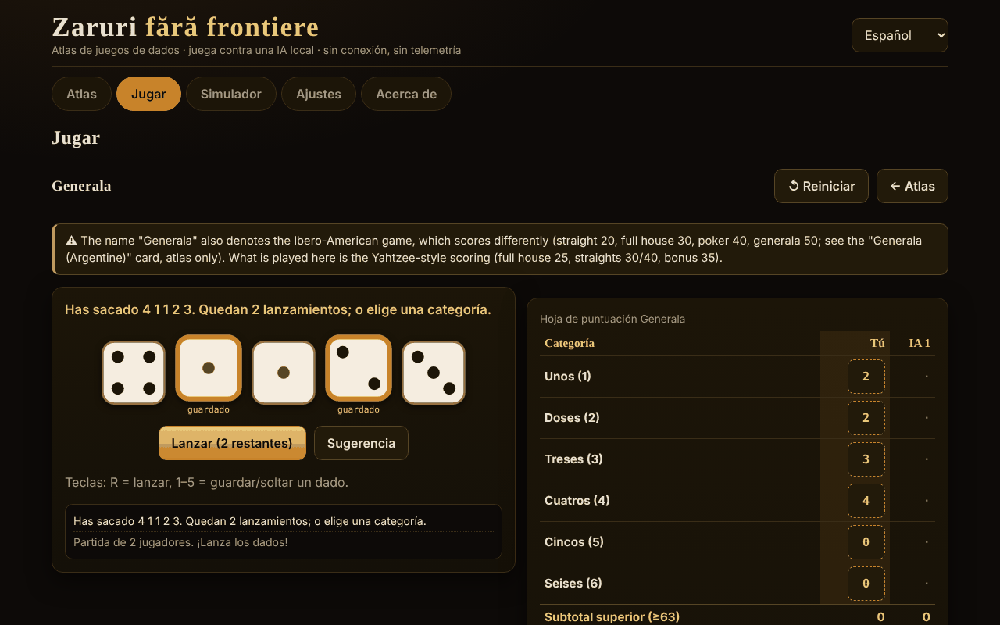

# Zaruri fără frontiere

[English](README.md) · [Română](README.ro.md) · [Français](README.fr.md) · [Italiano](README.it.md) · **Español** · [Português](README.pt.md) · [Deutsch](README.de.md) · [Magyar](README.hu.md)

**Versión:** 1.2.1 · **Última actualización:** 2026-10-19

Idiomas de la interfaz: **Română, English, Français, Italiano, Español, Português (PT), Deutsch, Magyar**

Atlas de juegos de dados y partidas contra una IA local — un único archivo HTML, sin conexión, sin dependencias y sin telemetría.

**En línea:** https://chiuta.github.io/Zaruri-fara-frontiere/

## Qué es

Un atlas de 26 fichas de juegos de dados, de las cuales **12 son jugables** contra una IA local (un motor didáctico, no un modelo de lenguaje) y 14 son **solo de atlas** (descritas, no implementadas). Además, un simulador de dados genérico. Todo se ejecuta en el navegador, desde un único `index.html`.

Esta **no es una aplicación de juegos de azar con dinero**: no hay apuestas reales, depósitos ni ganancias. El Craps usa solo fichas virtuales.

## Funciones (verificadas en el código y en las pruebas)

- **Dados**: `crypto.getRandomValues` con *rejection sampling* (sin sesgo de módulo). Opcionalmente, una *semilla* (mulberry32) para partidas reproducibles — en ese caso los dados son predecibles, y la aplicación lo indica.
- **Dados SVG grandes**, con puntos y `aria-label` con el valor; la animación del lanzamiento respeta `prefers-reduced-motion` y un interruptor en Ajustes.
- **Interfaz en 8 idiomas** (RO/EN/FR/IT/ES/PT/DE/HU) con selector y autodetección a partir de `navigator.languages`; `lang` actualizado dinámicamente.
- **Teclado**: todas las acciones tienen botones accesibles con Tab/Intro/Espacio; atajos para los dados (R = lanzar, 1–5 = conservar) donde corresponda; zonas táctiles ≥ 44 px; foco visible; mensajes `aria-live`; diseño sin desplazamiento horizontal a 390 px.
- **Estadísticas locales** (victorias/derrotas/empates) en `localStorage`, solo si está disponible; se pueden borrar desde Ajustes.
- **Simulador**: notación `NdM`, `+/−`, constantes (hasta 1 000 000 000), `d%`, conservar/descartar los más altos/más bajos (`kh/kl/dh/dl`), límites de 100 dados / 1000 caras / 12 términos, historial (los últimos 50 lanzamientos, conservado en local). La distribución exacta solo se calcula para expresiones con un rango ≤ 400 valores y bajo coste (de lo contrario se muestra una nota, no se bloquea la pestaña).
- **Análisis en el simulador** (expresiones con distribución exacta): consulta de probabilidad `P(S ≥ / ≤ / = v)` calculada a partir de la distribución exacta (con una proporción aproximada 1 : x); botón «Simular 10 000 lanzamientos» que compara la media y las frecuencias observadas con las exactas; «Copiar el historial».
- **Plurales** correctos en los mensajes con números (p. ej. «1 lanzamiento» / «2 lanzamientos») en los 8 idiomas.

## Variantes

| Variante | ¿Jugable? | ⚠ Aproximaciones / qué falta |
|---|---|---|
| Generala (reglas de tipo «Yahtzee®», marca de Hasbro) | sí, 2–4 jugadores | ⚠ El nombre «Generala» designa también el juego iberoamericano, con otra puntuación (escalera 20, full 30, póker 40, generala 50; ficha aparte, solo de atlas). Aquí: puntuación de tipo Yahtzee, bonus 35 con ≥ 63, bonus 100 solo si «Generala» = 50, regla oficial del comodín (forzado). Sin variantes regionales. |
| 10000 (Farkle) | sí, 2–4 | No existen reglas canónicas: preajuste «clásico» (solo 1, 5, trío; 4/5/6 iguales duplican), umbral de entrada y objetivo configurables, turno final opcional. |
| Greed (variante) | sí | Solo el preajuste «combinaciones» (escalera 1–6 y tres pares = 1500); NO es una regla canónica de «Greed». |
| Perudo (dado del mentiroso) | sí, 2–5 | Elecciones documentadas: palifico solo con ≥ 3 jugadores, calza permitida, apertura de ronda con 1 (comodines) prohibida (salvo palifico o un solo dado), el perdedor abre la ronda siguiente (tras una «calza» abre quien la dijo). |
| Dado del mentiroso (clásico) | sí, 2–5 | La variante mínima: sin comodines, sin calza, sin palifico. |
| Mia (Meyer) | sí, 2–4 | Reglas caseras variables; la variante «pasas el cubilete sin mirar» NO está implementada; anuncios estrictamente crecientes; una Mia impugnada correctamente cuesta 2 vidas. |
| Craps | sí, 1 jugador | Pass / Don't pass / Come / Don't come y odds a cuotas verdaderas (límites 1×, 2×, 3×, 5×, 10×, 3-4-5×). NO: Place, Field, Hardways, apuestas de proposición; las apuestas no se retiran; los odds en Come se desactivan en el «come-out»; 12 = empate en Don't. |
| Pig | sí | — (IA óptima calculada en local, Pig a 100) |
| Big Pig | sí | Variante: un solo 1 = pierdes el turno; doble 1 = 25; otros dobles = el doble de la suma. No existe una variante canónica. |
| Chicago | sí, 2–4 | Solo la variante simple (11 rondas, objetivo 2–12); sin versiones con apuestas. Juego de azar puro. |
| Shut the box | sí, tú contra la IA | Una ronda = un turno; 3/5/7 rondas, se suman las fichas restantes; regla del «un dado» opcional/obligatoria/nunca. |
| Dados de póker | sí, tú contra la IA | Manos 9–A, hasta 3 lanzamientos; desempate por tipo y luego por las caras de los grupos; igual = empate. |
| Generala argentina, Yacht, Yatzy | solo de atlas | Valores sin fuente única; las reglas varían. |
| Hazard, Sic Bo, Cee-lo, Ship-Captain-Crew, Crown & Anchor, Bunco, Barbut, Skunk, Pass the Pigs, dados no transitivos, dados de rol | solo de atlas | Resúmenes; «Pass the Pigs» no se puede simular sin probabilidades medidas; el Barbut tiene reglas inciertas. |

## IA — qué es y qué no es

No es un modelo de lenguaje. Son motores didácticos, cada uno descrito con honestidad en la ficha del juego:

- **Generala**: expectimax exacto sobre los 252 multiconjuntos de dados y las tablas de relanzamiento, más una estimación simple del «coste de oportunidad» de la categoría (parámetros ajustados empíricamente: puntuación media ≈ 241,5 en más de 300 partidas IA contra IA; no es óptima).
- **10000/Greed**: heurística (la probabilidad de Farkle y la ganancia esperada por enumeración, se planta en umbrales fijos). No es óptima.
- **Perudo/Dado del mentiroso**: probabilidades binomiales a partir de sus propios dados + el número total de dados + el historial de apuestas, decisión por valor esperado. En las pruebas nunca elige «calza».
- **Mia**: heurística simple; puede mentir.
- **Pig/Big Pig**: política óptima calculada en el navegador por iteración de valores (unos segundos en el primer arranque, con barra de progreso).
- **Shut the box**: programación dinámica exacta sobre los 512 estados de las fichas.
- **Dados de póker**: política exacta mediante tablas de transición.
- **Chicago/Craps**: sin IA de decisión (suerte).

**La IA no hace trampas.** No ve los dados ocultos de los demás (Perudo, Mia) y no conoce los lanzamientos futuros. Para el Perudo hay una prueba que permuta los dados de los oponentes y comprueba que la decisión de la IA sigue siendo idéntica. No hay barra de «dificultad»: no hay niveles.

## Guía de uso

1. Abre `index.html` (doble clic o desde la página En línea).
2. En **Atlas** exploras las fichas; los filtros y la búsqueda acotan la lista. «Reglas y notas» se abre en la ficha.
3. Pulsa **▶ Jugar** en una ficha jugable (o elige en la pestaña **Jugar**), ajusta las opciones y pulsa **Empezar**.
4. En tu turno: lanza (R), elige los dados que conservar (1–5) y la categoría/acción. Un mensaje `aria-live` anuncia lo ocurrido.
5. **Simulador**: escribe `2d6+3` y pulsa Lanzar.
6. **Ajustes**: animación, semilla (opcional), borrado de los datos locales.

Nota: cambiar de idioma durante una partida **reinicia** la partida en curso.

## Idiomas

Los elementos de la interfaz (botones, mensajes, menús, las reglas breves de cada juego) están en los 8 idiomas. **Los textos largos del atlas (reglas, orígenes, notas ⚠, descripción de la IA, sección Acerca de) existen solo en rumano e inglés**; en FR/IT/ES/PT/DE/HU el texto se muestra en inglés, marcado `lang="en"`, con una discreta nota «texto en inglés». Una prueba comprueba la paridad de las claves i18n y de las sustituciones `{…}` entre los 8 idiomas.

## Privacidad y red

- Cero solicitudes de red: CSP estricta `default-src 'none'`, `script-src` solo mediante hash sha256 (3 scripts en línea), `style-src 'unsafe-inline'` (necesario para los estilos establecidos desde la interfaz), `img-src data:`, sin `connect-src`. No hay `fetch`, `eval` ni `innerHTML` (verificado buscando en el archivo entregado).
- `localStorage` solo dentro de `try/catch` (idioma, animación, semilla, estadísticas, historial del simulador — los últimos 50 lanzamientos; se borra desde Ajustes); la aplicación funciona también sin él.
- Los únicos enlaces externos están en el pie de página/esquina de la página: Buy Me a Coffee y GitHub, con `rel="noopener"`.
- Sin cuenta, sin cookies, sin analítica.

## Límites y advertencias

- No es un juego de azar con dinero; las fichas del Craps son virtuales.
- Los nombres comerciales citados (Yahtzee®, Perudo®, Pass the Pigs®, Kniffel®) pertenecen a sus propietarios; la aplicación no está afiliada. Los títulos usan nombres tradicionales/genéricos; «Perudo» y «Farkle» se usan, sin embargo, también comercialmente por otros fabricantes (mantenerlos en el título es una decisión del autor).
- Las variantes marcadas ⚠ son aproximaciones o elecciones documentadas, no «la regla oficial».
- Pig: el cálculo de la política óptima tarda unos segundos en teléfonos lentos.
- No implementado: símbolos alternativos para el daltonismo (los dados usan puntos, no colores, para el valor), modo «mostrar los dados de la IA».
- Las pruebas automáticas están en el espacio de trabajo del autor, no en el paquete (véase el informe).

## Fuentes

- Reglas del Yahtzee/Generala (categorías, bonus 35, bonus 100, regla oficial del comodín): Wikipedia, «Yahtzee» (verificado en esta sesión) y las reglas publicadas por el fabricante (de memoria; no comparadas con el texto oficial).
- Pig óptimo (≈ 53,06 % para el primer jugador a 100): el artículo «Optimal Play of the Dice Game Pig» (The UMAP Journal, 2004); el valor se reprodujo con un cálculo propio en las pruebas (dentro de una tolerancia de 0,0006).
- Dado del mentiroso / Perudo, Mia, Pig, Craps, Shut the box, Farkle: los artículos respectivos de Wikipedia y descripciones de reglas de juego; las reglas exactas varían y las variantes elegidas se enumeran arriba.
- Craps: la probabilidad de la pass-line 244/495 verificada por cálculo exacto y simulación; cuotas verdaderas 2:1 / 3:2 / 6:5 (y 1:2 / 2:3 / 5:6 para el «lay») y 3-4-5× según Wikipedia, «Craps».
- Perudo/Dudo (orden de las apuestas, 1 como comodín, palifico, calza, apertura): Wikipedia, «Dudo»; reglamento del Perudo publicado en rulespal.com.
- Mia: Wikipedia, «Mia (game)» (orden 31 … 65, 11 … 66, 21; Mia impugnada correctamente = 2 vidas). Aquí el anuncio debe ser *estrictamente* mayor que el anterior (algunas fuentes aceptan «igual o mayor»).
- Big Pig (un solo 1 = pierdes el turno, doble 1 = 25, otros dobles = el doble de la suma): descripción didáctica usada en cursos de programación; no existe una regla canónica.
- Generala iberoamericana (valores citados en el atlas): Wikipedia, «Generala».
- Auditoría independiente: las reglas anteriores fueron releídas por un segundo agente;.

## Ejecución local

No necesita compilación, servidor ni instalación: abre `index.html` en un navegador moderno.

## Historial / Changelog

### 1.1.0 — 2026-10-14
- Copia de seguridad y etiquetado de datos (fff-kit).

### 12 de octubre de 2026 — versión 1.0.0
- 1.0.0 — 2026-10-12: la versión y la fecha de la última actualización se muestran en la aplicación

### 11 de octubre de 2026 (tercera pasada)
- Simulador: el resultado detallado es inequívoco (`4d6kh3 [2, 4, 3, 4] → [3, 4, 4] = 11  ·  + 2`; las constantes ya no aparecen como «= 2»); el historial de lanzamientos se conserva en local entre sesiones (los últimos 50, validado al leer, borrado desde Ajustes → datos). CSP: hashes recalculados.

### 11 de octubre de 2026 (segunda pasada)
- Simulador: probabilidad `P(S ≥/≤/= v)` a partir de la distribución exacta, simulación de 10 000 lanzamientos con comparación observado/exacto, copia del historial (textos nuevos en 7 idiomas); títulos de la distribución pasados a `h3` (orden correcto de los títulos); CSP: hashes recalculados.

### 11 de octubre de 2026
- Accesibilidad: el widget de apoyo Buy Me a Coffee tiene ahora un rol de punto de referencia (`complementary`); axe-core informa de 0 infracciones a 1280 y 360 px. Los scripts y los hashes CSP no se modificaron.

## Licencia

MIT — véase el archivo LICENSE.

## Autor

Alexandru-Ionuț Chiuță (Alexio).

## Resumen

Un atlas de juegos de dados sin conexión, de un solo archivo, con 26 fichas; 12 son jugables contra una IA local no LLM (Generala, 10000/Farkle, variante Greed, Perudo, dado del mentiroso clásico, Mia, Craps con fichas virtuales, Pig, Big Pig, Chicago, Shut the box, dados de póker) y el resto son solo de atlas. Los dados usan `crypto.getRandomValues` con rejection sampling (semilla opcional). Sin red (CSP estricta), sin telemetría, no es juego de azar con dinero. Interfaz en 8 idiomas; los textos largos de las reglas existen solo en rumano e inglés (los demás idiomas muestran inglés). La IA no hace trampas. Las variantes marcadas ⚠ son aproximaciones o elecciones caseras documentadas. Licencia: MIT (véase LICENSE).
