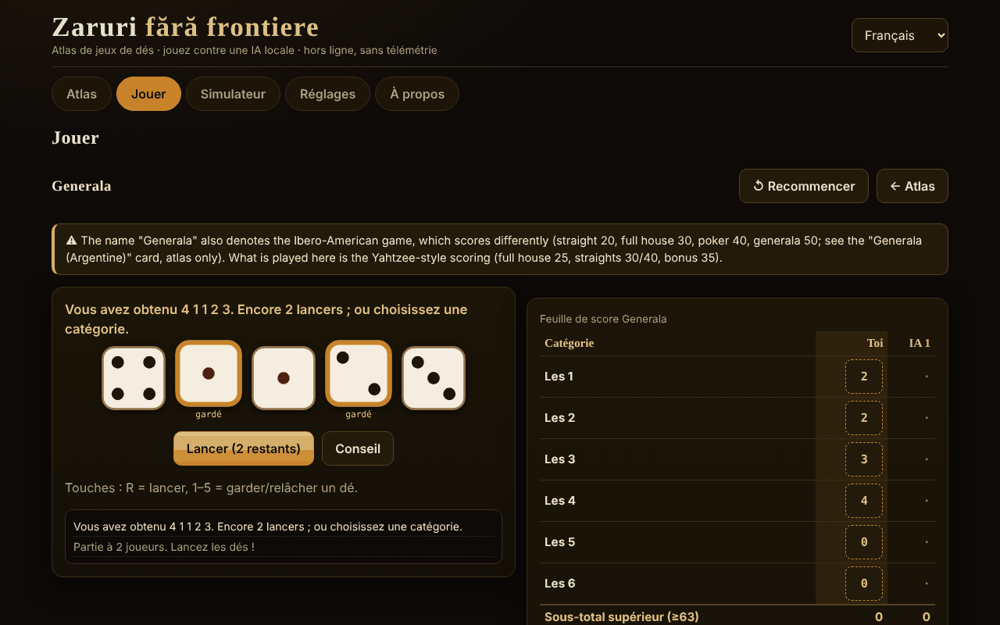

# Zaruri fără frontiere

[English](README.md) · [Română](README.ro.md) · **Français** · [Italiano](README.it.md) · [Español](README.es.md) · [Português](README.pt.md) · [Deutsch](README.de.md) · [Magyar](README.hu.md)

**Version :** 1.2.4 · **Dernière mise à jour :** 2026-10-22

Langues de l'interface : **Română, English, Français, Italiano, Español, Português (PT), Deutsch, Magyar**

Atlas de jeux de dés et parties contre une IA locale — un seul fichier HTML, hors ligne, sans dépendances ni télémétrie.

**En ligne :** https://chiuta.github.io/Zaruri-fara-frontiere/

## De quoi s'agit-il

Un atlas de 26 fiches de jeux de dés, dont **12 sont jouables** contre une IA locale (un moteur didactique, et non un modèle de langage) et 14 sont **uniquement dans l'atlas** (décrites, non implémentées). Plus un simulateur de dés générique. Tout s'exécute dans le navigateur, à partir d'un seul `index.html`.

Ce **n'est pas une application de jeux d'argent** : il n'y a ni mises réelles, ni dépôts, ni gains. Le Craps n'utilise que des jetons virtuels.

## Fonctionnalités (vérifiées dans le code et dans les tests)

- **Dés** : `crypto.getRandomValues` avec *rejection sampling* (sans biais de modulo). En option, une *graine* (mulberry32) pour des parties reproductibles — les dés sont alors prévisibles, et l'application le signale.
- **Grands dés SVG**, avec points et `aria-label` indiquant la valeur ; l'animation du lancer respecte `prefers-reduced-motion` et un commutateur dans les Réglages.
- **Interface en 8 langues** (RO/EN/FR/IT/ES/PT/DE/HU) avec sélecteur et détection automatique via `navigator.languages` ; `lang` mis à jour dynamiquement.
- **Clavier** : toutes les actions ont des boutons accessibles avec Tab/Entrée/Espace ; raccourcis pour les dés (R = lancer, 1–5 = garder) lorsque cela s'applique ; zones tactiles ≥ 44 px ; focus visible ; messages `aria-live` ; mise en page sans défilement horizontal à 390 px.
- **Statistiques locales** (victoires/défaites/nuls) dans `localStorage`, uniquement s'il est disponible ; elles peuvent être effacées depuis les Réglages.
- **Simulateur** : notation `NdM`, `+/−`, constantes (jusqu'à 1 000 000 000), `d%`, garder/éliminer les plus hauts/plus bas (`kh/kl/dh/dl`), limites de 100 dés / 1000 faces / 12 termes, historique (les 50 derniers lancers, conservé localement). La distribution exacte n'est calculée que pour les expressions dont l'étendue est ≤ 400 valeurs et dont le coût est faible (sinon une note s'affiche, l'onglet n'est pas bloqué).
- **Analyse dans le simulateur** (expressions à distribution exacte) : requête de probabilité `P(S ≥ / ≤ / = v)` calculée à partir de la distribution exacte (avec un rapport approximatif 1 : x) ; bouton « Simuler 10 000 lancers » qui compare la moyenne et les fréquences observées aux valeurs exactes ; « Copier l'historique ».
- **Pluriels** corrects dans les messages comportant des nombres (p. ex. « 1 lancer » / « 2 lancers ») dans les 8 langues.

## Variantes

| Variante | Jouable ? | ⚠ Approximations / ce qui manque |
|---|---|---|
| Generala (règles de type « Yahtzee® », marque de Hasbro) | oui, 2–4 joueurs | ⚠ Le nom « Generala » désigne aussi le jeu ibéro-américain, avec un autre barème (suite 20, full 30, carré 40, generala 50 ; fiche distincte, uniquement dans l'atlas). Ici : barème de type Yahtzee, bonus 35 à ≥ 63, bonus 100 seulement si « Generala » = 50, règle officielle du joker (forcé). Pas de variantes régionales. |
| 10000 (Farkle) | oui, 2–4 | Il n'existe pas de règles canoniques : préréglage « classique » (seulement 1, 5, brelan ; 4/5/6 identiques doublent), seuil d'entrée et objectif configurables, tour final optionnel. |
| Greed (variante) | oui | Uniquement le préréglage « combinaisons » (suite 1–6 et trois paires = 1500) ; ce n'est PAS une règle canonique de « Greed ». |
| Perudo (dés du menteur) | oui, 2–5 | Choix documentés : palifico seulement à ≥ 3 joueurs, calza autorisée, ouverture de manche avec des 1 (jokers) interdite (sauf palifico ou un seul dé), le perdant ouvre la manche suivante (après une « calza », c'est celui qui l'a annoncée qui ouvre). |
| Dés du menteur (classique) | oui, 2–5 | Variante minimale : sans jokers, sans calza, sans palifico. |
| Mia (Meyer) | oui, 2–4 | Règles maison variables ; la variante « on passe le gobelet sans le regarder » n'est PAS implémentée ; annonces strictement croissantes ; une Mia contestée à raison coûte 2 vies. |
| Craps | oui, 1 joueur | Pass / Don't pass / Come / Don't come et cotes à vraies cotes (limites 1×, 2×, 3×, 5×, 10×, 3-4-5×). PAS : Place, Field, Hardways, paris de proposition ; les paris ne se retirent pas ; les cotes sur Come sont désactivées au « come-out » ; 12 = égalité sur Don't. |
| Pig | oui | — (IA optimale calculée localement, Pig à 100) |
| Big Pig | oui | Variante : un seul 1 = vous perdez le tour ; double 1 = 25 ; autres doubles = double de la somme. Il n'existe pas de variante canonique. |
| Chicago | oui, 2–4 | Uniquement la variante simple (11 manches, objectif 2–12) ; pas de versions avec mises. Pur jeu de hasard. |
| Shut the box | oui, vous contre l'IA | Une manche = un tour ; 3/5/7 manches, on additionne les plaquettes restantes ; règle du « un seul dé » facultative/obligatoire/jamais. |
| Dés de poker | oui, vous contre l'IA | Mains 9–A, jusqu'à 3 lancers ; départage par type, puis par les faces des groupes ; égalité = nul. |
| Generala argentine, Yacht, Yatzy | uniquement dans l'atlas | Valeurs sans source unique ; les règles varient. |
| Hazard, Sic Bo, Cee-lo, Ship-Captain-Crew, Crown & Anchor, Bunco, Barbut, Skunk, Pass the Pigs, dés non transitifs, dés de jeu de rôle | uniquement dans l'atlas | Résumés ; « Pass the Pigs » ne peut pas être simulé sans probabilités mesurées ; Barbut a des règles incertaines. |

## IA — ce qu'elle est et ce qu'elle n'est pas

Ce n'est pas un modèle de langage. Ce sont des moteurs didactiques, chacun décrit honnêtement dans la fiche du jeu :

- **Generala** : expectimax exact sur les 252 multi-ensembles de dés et les tables de relance, plus une estimation simple du « coût d'opportunité » de la catégorie (paramètres réglés empiriquement : score moyen ≈ 241,5 sur 300+ parties IA contre IA ; ce n'est pas optimal).
- **10000/Greed** : heuristique (la probabilité de Farkle et le gain espéré par énumération, encaisse à des seuils fixes). Ce n'est pas optimal.
- **Perudo/Dés du menteur** : probabilités binomiales à partir de ses propres dés + nombre total de dés + historique des enchères, décision par valeur espérée. Dans les tests, elle ne choisit jamais « calza ».
- **Mia** : heuristique simple ; elle peut mentir.
- **Pig/Big Pig** : politique optimale calculée dans le navigateur par itération de valeurs (quelques secondes au premier lancement, avec barre de progression).
- **Shut the box** : programmation dynamique exacte sur les 512 états des plaquettes.
- **Dés de poker** : politique exacte par tables de transition.
- **Chicago/Craps** : pas d'IA de décision (hasard).

**L'IA ne triche pas.** Elle ne voit pas les dés cachés des autres (Perudo, Mia) et ne connaît pas les lancers futurs. Pour le Perudo, un test permute les dés des adversaires et vérifie que la décision de l'IA reste identique. Il n'y a pas de curseur de « difficulté » : il n'y a pas de niveaux.

## Mode d'emploi

1. Ouvrez `index.html` (double-clic ou depuis la page En ligne).
2. Dans **Atlas**, vous parcourez les fiches ; les filtres et la recherche restreignent la liste. « Règles et notes » s'ouvre sur la fiche.
3. Appuyez sur **▶ Jouer** sur une fiche jouable (ou choisissez dans l'onglet **Jouer**), réglez les options et appuyez sur **Commencer**.
4. À votre tour : lancez (R), choisissez les dés à garder (1–5) et la catégorie/l'action. Un message `aria-live` annonce ce qui s'est passé.
5. **Simulateur** : saisissez `2d6+3` et appuyez sur Lancer.
6. **Réglages** : animation, graine (facultative), suppression des données locales.

Remarque : changer de langue pendant une partie **redémarre** la partie en cours.

## Langues

Les éléments d'interface (boutons, messages, menus, règles courtes de chaque jeu) sont dans les 8 langues. **Les textes longs de l'atlas (règles, origines, notes ⚠, description de l'IA, section À propos) n'existent qu'en roumain et en anglais** ; en FR/IT/ES/PT/DE/HU, le texte s'affiche en anglais, marqué `lang="en"`, avec une discrète note « texte en anglais ». Un test vérifie la parité des clés i18n et des substitutions `{…}` entre les 8 langues.

## Confidentialité et réseau

- Zéro requête réseau : CSP stricte `default-src 'none'`, `script-src` uniquement par empreinte sha256 (3 scripts en ligne), `style-src 'unsafe-inline'` (nécessaire pour les styles définis depuis l'interface), `img-src data:`, sans `connect-src`. Il n'y a ni `fetch`, ni `eval`, ni `innerHTML` (vérifié par recherche dans le fichier livré).
- `localStorage` uniquement dans des `try/catch` (langue, animation, graine, statistiques, historique du simulateur — les 50 derniers lancers ; effacé depuis les Réglages) ; l'application fonctionne aussi sans lui.
- Les seuls liens externes se trouvent dans le pied de page/le coin de la page : Buy Me a Coffee et GitHub, avec `rel="noopener"`.
- Pas de compte, pas de cookies, pas d'analyse.

## Limites et avertissements

- Ce n'est pas un jeu d'argent ; les jetons du Craps sont virtuels.
- Les noms commerciaux cités (Yahtzee®, Perudo®, Pass the Pigs®, Kniffel®) appartiennent à leurs propriétaires ; l'application n'est pas affiliée. Les titres utilisent des noms traditionnels/génériques ; « Perudo » et « Farkle » sont toutefois aussi utilisés commercialement par d'autres éditeurs (les conserver dans le titre est une décision de l'auteur).
- Les variantes marquées ⚠ sont des approximations ou des choix documentés, et non « la règle officielle ».
- Pig : le calcul de la politique optimale prend quelques secondes sur les téléphones lents.
- Non implémenté : symboles alternatifs pour le daltonisme (les dés utilisent des points, et non des couleurs, pour la valeur), mode « montrer les dés de l'IA ».
- Les tests automatisés se trouvent dans l'espace de travail de l'auteur, et non dans le paquet (voir le rapport).

## Sources

- Règles du Yahtzee/Generala (catégories, bonus 35, bonus 100, règle officielle du joker) : Wikipédia, « Yahtzee » (vérifié lors de cette session) et les règles publiées par le fabricant (de mémoire ; non comparées au texte officiel).
- Pig optimal (≈ 53,06 % pour le premier joueur à 100) : l'article « Optimal Play of the Dice Game Pig » (The UMAP Journal, 2004) ; la valeur a été reproduite par un calcul propre dans les tests (dans une tolérance de 0,0006).
- Dés du menteur / Perudo, Mia, Pig, Craps, Shut the box, Farkle : les articles Wikipédia correspondants et des descriptions de règles de jeu ; les règles exactes varient et les variantes choisies sont énumérées plus haut.
- Craps : la probabilité de la pass-line 244/495 vérifiée par calcul exact et simulation ; cotes vraies 2:1 / 3:2 / 6:5 (et 1:2 / 2:3 / 5:6 pour le « lay ») et 3-4-5× d'après Wikipédia, « Craps ».
- Perudo/Dudo (ordre des enchères, 1 jokers, palifico, calza, ouverture) : Wikipédia, « Dudo » ; règlement du Perudo publié sur rulespal.com.
- Mia : Wikipédia, « Mia (game) » (ordre 31 … 65, 11 … 66, 21 ; Mia contestée à raison = 2 vies). Ici, l'annonce doit être *strictement* supérieure à la précédente (certaines sources acceptent « égale ou supérieure »).
- Big Pig (un seul 1 = vous perdez le tour, double 1 = 25, autres doubles = double de la somme) : description didactique utilisée dans les cours de programmation ; il n'existe pas de règle canonique.
- Generala ibéro-américaine (valeurs citées dans l'atlas) : Wikipédia, « Generala ».
- Audit indépendant : les règles ci-dessus ont été relues par un second agent;.

## Exécution en local

Elle ne nécessite ni build, ni serveur, ni installation : ouvrez `index.html` dans un navigateur moderne.

## Historique / Changelog

### 1.2.4 — 2026-10-22
- fff-kit 1.1.2 : PBKDF2 à 600 000 itérations, protection anti-clickjacking.

### 1.2.3 — 2026-10-22
- Tous les sous-titres restés uniquement en anglais (Poker dice, Greed (variant), Liar’s dice (classic), Non-transitive dice, Generala (Argentine), Perudo, 10000 / Farkle, Shut the box, Pass the Pigs) figurent désormais dans le dictionnaire de langue, pour les 8 langues.

### 1.2.2 — 2026-10-22
- Traduction des libellés restés en anglais « Generala (five-dice game) » et « Role-playing dice (d4–d100) » dans les 8 langues ; l’interface anglaise affiche désormais des titres de fiches en anglais.

### 1.1.0 — 2026-10-14
- Sauvegarde et étiquetage des données (fff-kit).

### 12 octobre 2026 — version 1.0.0
- 1.0.0 — 2026-10-12 : la version et la date de la dernière mise à jour sont affichées dans l'application

### 11 octobre 2026 (troisième passage)
- Simulateur : le résultat détaillé est sans ambiguïté (`4d6kh3 [2, 4, 3, 4] → [3, 4, 4] = 11  ·  + 2` ; les constantes n'apparaissent plus comme « = 2 ») ; l'historique des lancers est conservé localement entre les sessions (les 50 derniers, validé à la lecture, effacé depuis Réglages → données). CSP : empreintes recalculées.

### 11 octobre 2026 (deuxième passage)
- Simulateur : probabilité `P(S ≥/≤/= v)` à partir de la distribution exacte, simulation de 10 000 lancers avec comparaison observé/exact, copie de l'historique (nouveaux textes dans 7 langues) ; titres de la distribution passés en `h3` (ordre correct des titres) ; CSP : empreintes recalculées.

### 11 octobre 2026
- Accessibilité : le widget de soutien Buy Me a Coffee a désormais un rôle de repère (`complementary`) ; axe-core signale 0 violation à 1280 et 360 px. Les scripts et les empreintes CSP n'ont pas été modifiés.

## Licence

MIT — voir le fichier LICENSE.

## Auteur

Alexandru-Ionuț Chiuță (Alexio).

## Résumé

Un atlas de jeux de dés hors ligne, en un seul fichier, de 26 fiches ; 12 sont jouables contre une IA locale non LLM (Generala, 10000/Farkle, variante Greed, Perudo, dés du menteur classique, Mia, Craps avec jetons virtuels, Pig, Big Pig, Chicago, Shut the box, dés de poker) et les autres sont uniquement dans l'atlas. Les dés utilisent `crypto.getRandomValues` avec rejection sampling (graine facultative). Pas de réseau (CSP stricte), pas de télémétrie, pas de jeu d'argent. Interface en 8 langues ; les textes longs des règles n'existent qu'en roumain et en anglais (les autres langues affichent l'anglais). L'IA ne triche pas. Les variantes marquées ⚠ sont des approximations ou des choix maison documentés. Licence : MIT (voir LICENSE).
