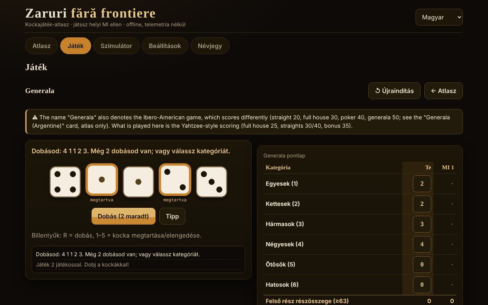

# Zaruri fără frontiere

[English](README.md) · [Română](README.ro.md) · [Français](README.fr.md) · [Italiano](README.it.md) · [Español](README.es.md) · [Português](README.pt.md) · [Deutsch](README.de.md) · **Magyar**

**Verzió:** 1.2.3 · **Utolsó frissítés:** 2026-10-22

A felület nyelvei: **Română, English, Français, Italiano, Español, Português (PT), Deutsch, Magyar**

Kockajátékok atlasza és játszmák egy helyi mesterséges intelligencia ellen — egyetlen HTML-fájl, offline, függőségek és telemetria nélkül.

**Élő változat:** https://chiuta.github.io/Zaruri-fara-frontiere/

## Mi ez

26 kockajáték-lap atlasza, amelyek közül **12 játszható** egy helyi MI ellen (didaktikus motor, nem nyelvi modell), 14 pedig **csak az atlaszban** szerepel (leírva, de nem megvalósítva). Ezenkívül egy általános kockaszimulátor. Minden a böngészőben fut, egyetlen `index.html` fájlból.

Ez **nem pénzben játszott szerencsejáték-alkalmazás**: nincsenek valódi tétek, befizetések vagy nyeremények. A Craps csak virtuális zsetonokat használ.

## Funkciók (kódban és tesztekben ellenőrizve)

- **Kockák**: `crypto.getRandomValues` *rejection sampling*-gel (modulo-torzítás nélkül). Opcionálisan egy *seed* (mulberry32) az ismételhető játszmákhoz — ilyenkor a kockák megjósolhatók, és az alkalmazás ezt jelzi.
- **Nagy SVG-kockák**, pöttyökkel és az értéket tartalmazó `aria-label`-lel; a dobás animációja tiszteletben tartja a `prefers-reduced-motion` beállítást és a Beállítások egyik kapcsolóját.
- **Felület 8 nyelven** (RO/EN/FR/IT/ES/PT/DE/HU) nyelvváltóval és a `navigator.languages` alapján történő automatikus észleléssel; a `lang` dinamikusan frissül.
- **Billentyűzet**: minden műveletnek van Tabbal/Enterrel/Szóközzel elérhető gombja; billentyűparancsok a kockákhoz (R = dobás, 1–5 = megtartás), ahol van értelme; érintési felületek ≥ 44 px; látható fókusz; `aria-live` üzenetek; elrendezés vízszintes görgetés nélkül 390 px-en.
- **Helyi statisztikák** (győzelmek/vereségek/döntetlenek) a `localStorage`-ban, csak ha elérhető; a Beállításokban törölhetők.
- **Szimulátor**: `NdM` jelölés, `+/−`, állandók (legfeljebb 1 000 000 000), `d%`, a legnagyobbak/legkisebbek megtartása/elhagyása (`kh/kl/dh/dl`), korlátok: 100 kocka / 1000 oldal / 12 tag, előzmények (az utolsó 50 dobás, helyben tárolva). A pontos eloszlást csak legfeljebb 400 értékű tartományú és kis költségű kifejezésekre számolja ki (egyébként megjegyzés jelenik meg, a lap nem fagy le).
- **Elemzés a szimulátorban** (pontos eloszlású kifejezések): `P(S ≥ / ≤ / = v)` valószínűségi lekérdezés a pontos eloszlásból számolva (közelítő 1 : x aránnyal); „10 000 dobás szimulálása” gomb, amely összeveti a megfigyelt átlagot és gyakoriságokat a pontosakkal; „Előzmények másolása”.
- Helyes **többes szám** a számokat tartalmazó üzenetekben (pl. „1 dobás” / „2 dobás”) mind a 8 nyelven.

## Változatok

| Változat | Játszható? | ⚠ Közelítések / mi hiányzik |
|---|---|---|
| Generala („Yahtzee®” típusú szabályok, a Hasbro védjegye) | igen, 2–4 játékos | ⚠ A „Generala” név az ibero-amerikai játékot is jelöli, más pontozással (sor 20, full 30, póker 40, generala 50; külön lap, csak az atlaszban). Itt: Yahtzee-típusú pontozás, 35-ös bónusz ≥ 63-nál, 100-as bónusz csak ha a „Generala” = 50, hivatalos dzsóker-szabály (kötelező). Regionális változatok nélkül. |
| 10000 (Farkle) | igen, 2–4 | Nincsenek kanonikus szabályok: „klasszikus” előbeállítás (csak 1-esek, 5-ösök, három egyforma; 4/5/6 egyforma megduplázza), beállítható belépési küszöb és cél, opcionális záró kör. |
| Greed (változat) | igen | Csak a „kombinációk” előbeállítás (1–6 sor és három pár = 1500); NEM kanonikus „Greed”-szabály. |
| Perudo (hazudós kocka) | igen, 2–5 | Dokumentált döntések: palifico csak ≥ 3 játékosnál, calza engedélyezett, a kör 1-esekkel (dzsókerekkel) való nyitása tiltott (kivéve palifico vagy egyetlen kocka esetén), a vesztes nyitja a következő kört (egy „calza” után az nyit, aki bemondta). |
| Hazudós kocka (klasszikus) | igen, 2–5 | A minimális változat: dzsókerek, calza és palifico nélkül. |
| Mia (Meyer) | igen, 2–4 | A házi szabályok változóak; az „a nem látott poharat adod tovább” változat NINCS megvalósítva; szigorúan növekvő bemondások; egy jogosan megkérdőjelezett Mia 2 életbe kerül. |
| Craps | igen, 1 játékos | Pass / Don't pass / Come / Don't come és odds valódi oddsokon (korlátok 1×, 2×, 3×, 5×, 10×, 3-4-5×). NINCS: Place, Field, Hardways, proposition fogadások; a fogadások nem vonhatók vissza; a Come-oddsok a come-outnál ki vannak kapcsolva; 12 = push a Don't-nál. |
| Pig | igen | — (helyben kiszámolt optimális MI, Pig 100-ig) |
| Big Pig | igen | Változat: egyetlen 1-es = elveszíted a kört; dupla 1 = 25; más dupla = az összeg duplája. Nincs kanonikus változat. |
| Chicago | igen, 2–4 | Csak az egyszerű változat (11 kör, cél 2–12); tétes változatok nincsenek. Tiszta szerencsejáték. |
| Shut the box | igen, te az MI ellen | Egy kör = egy forduló; 3/5/7 kör, a megmaradt lapkákat összeadják; az „egy kocka” szabály választható/kötelező/soha. |
| Pókerkockák | igen, te az MI ellen | 9–A kezek, legfeljebb 3 dobás; döntetlen feloldása típus szerint, majd a csoportok oldalai szerint; egyenlő = döntetlen. |
| Argentin Generala, Yacht, Yatzy | csak az atlaszban | Az értékeknek nincs egyértelmű forrásuk; a szabályok változnak. |
| Hazard, Sic Bo, Cee-lo, Ship-Captain-Crew, Crown & Anchor, Bunco, Barbut, Skunk, Pass the Pigs, nem tranzitív kockák, szerepjátékkockák | csak az atlaszban | Összefoglalók; a „Pass the Pigs” nem szimulálható mért valószínűségek nélkül; a Barbut szabályai bizonytalanok. |

## MI — mi ez és mi nem

Nem nyelvi modell. Didaktikus motorok, mindegyiket őszintén leírja a játék lapja:

- **Generala**: pontos expectimax a kockák 252 multihalmazán és az újradobási táblákon, plusz a kategória „alternatív költségének” egyszerű becslése (empirikusan hangolt paraméterek: átlagpontszám ≈ 241,5 több mint 300 MI–MI játszmában; nem optimális).
- **10000/Greed**: heurisztika (a Farkle esélye és a várható nyereség felsorolással, rögzített küszöböknél elmenti a pontokat). Nem optimális.
- **Perudo/Hazudós kocka**: binomiális valószínűségek a saját kockákból + a kockák teljes száma + a licitelőzmények alapján, döntés a várható érték szerint. A tesztekben soha nem választja a „calza”-t.
- **Mia**: egyszerű heurisztika; hazudhat.
- **Pig/Big Pig**: a böngészőben értékiterációval kiszámolt optimális stratégia (néhány másodperc az első indításkor, folyamatjelzővel).
- **Shut the box**: pontos dinamikus programozás a lapkák 512 állapotán.
- **Pókerkockák**: pontos stratégia átmeneti táblákkal.
- **Chicago/Craps**: nincs döntési MI (szerencse).

**Az MI nem csal.** Nem látja mások rejtett kockáit (Perudo, Mia), és nem ismeri a jövőbeli dobásokat. A Perudóhoz van egy teszt, amely permutálja az ellenfelek kockáit, és ellenőrzi, hogy az MI döntése azonos marad. Nincs „nehézségi” sáv: nincsenek szintek.

## Használati útmutató

1. Nyisd meg az `index.html` fájlt (dupla kattintás vagy az Élő oldalról).
2. Az **Atlasz** alatt lapozod a lapokat; a szűrők és a keresés szűkítik a listát. A „Szabályok és megjegyzések” a lapon nyílik meg.
3. Nyomd meg a **▶ Játék** gombot egy játszható lapon (vagy válassz a **Játék** lapon), állítsd be a beállításokat, és nyomd meg a **Kezdés** gombot.
4. A saját körödben: dobj (R), válaszd ki a megtartandó kockákat (1–5) és a kategóriát/műveletet. Egy `aria-live` üzenet bejelenti, mi történt.
5. **Szimulátor**: írd be, hogy `2d6+3`, és nyomd meg a Dobás gombot.
6. **Beállítások**: animáció, seed (opcionális), a helyi adatok törlése.

Megjegyzés: a nyelv játék közbeni váltása **újraindítja** az éppen folyó játszmát.

## Nyelvek

A felületi elemek (gombok, üzenetek, menük, az egyes játékok rövid szabályai) mind a 8 nyelven megvannak. **Az atlasz hosszú szövegei (szabályok, eredet, ⚠ megjegyzések, az MI leírása, a Névjegy szakasz) csak románul és angolul léteznek**; FR/IT/ES/PT/DE/HU nyelven a szöveg angolul jelenik meg, `lang="en"` jelöléssel és egy diszkrét „szöveg angolul” megjegyzéssel. Egy teszt ellenőrzi az i18n-kulcsok és a `{…}` helyettesítések egyezését a 8 nyelv között.

## Adatvédelem és hálózat

- Nulla hálózati kérés: szigorú CSP `default-src 'none'`, `script-src` csak sha256 hash alapján (3 beágyazott szkript), `style-src 'unsafe-inline'` (a felületről beállított stílusokhoz szükséges), `img-src data:`, `connect-src` nélkül. Nincs `fetch`, `eval` vagy `innerHTML` (a leszállított fájlban való kereséssel ellenőrizve).
- A `localStorage` csak `try/catch`-en belül (nyelv, animáció, seed, statisztikák, a szimulátor előzményei — az utolsó 50 dobás; a Beállításokban törölhető); az alkalmazás nélküle is működik.
- Az egyetlen külső hivatkozás az oldal láblécében/sarkában van: Buy Me a Coffee és GitHub, `rel="noopener"` jelöléssel.
- Nincs fiók, nincsenek sütik, nincs elemzés.

## Korlátok és figyelmeztetések

- Nem pénzben játszott szerencsejáték; a Craps zsetonjai virtuálisak.
- Az idézett kereskedelmi nevek (Yahtzee®, Perudo®, Pass the Pigs®, Kniffel®) tulajdonosaiké; az alkalmazás nem kapcsolódik hozzájuk. A címek hagyományos/általános neveket használnak; a „Perudo” és a „Farkle” nevet azonban más gyártók is használják kereskedelmi célra (a címben való megtartásuk a szerző döntése).
- A ⚠ jelölésű változatok közelítések vagy dokumentált döntések, nem „a hivatalos szabály”.
- Pig: az optimális stratégia kiszámítása lassú telefonokon néhány másodpercig tart.
- Nincs megvalósítva: alternatív szimbólumok színtévesztőknek (a kockák az értéket pöttyökkel, nem színekkel jelzik), „az MI kockáinak mutatása” mód.
- Az automatizált tesztek a szerző munkaterületén vannak, nem a csomagban (lásd a jelentést).

## Források

- Yahtzee/Generala szabályok (kategóriák, 35-ös bónusz, 100-as bónusz, hivatalos dzsóker-szabály): Wikipedia, „Yahtzee” (ebben az ülésben ellenőrizve) és a gyártó által közzétett szabályok (emlékezetből; a hivatalos szöveggel nem vetettük össze).
- Optimális Pig (≈ 53,06% az első játékosnak 100-nál): az „Optimal Play of the Dice Game Pig” című tanulmány (The UMAP Journal, 2004); az értéket a tesztekben saját számítással reprodukáltuk (0,0006-os tűréshatáron belül).
- Hazudós kocka / Perudo, Mia, Pig, Craps, Shut the box, Farkle: a megfelelő Wikipedia-cikkek és játékszabály-leírások; a pontos szabályok változnak, a választott változatok fent vannak felsorolva.
- Craps: a pass-line 244/495 valószínűsége pontos számítással és szimulációval ellenőrizve; valódi oddsok 2:1 / 3:2 / 6:5 (és 1:2 / 2:3 / 5:6 a „lay”-hez) és 3-4-5× a Wikipedia „Craps” szócikke szerint.
- Perudo/Dudo (a licitek sorrendje, az 1-esek mint dzsókerek, palifico, calza, nyitás): Wikipedia, „Dudo”; a rulespal.com oldalon közzétett Perudo-szabályzat.
- Mia: Wikipedia, „Mia (game)” (sorrend 31 … 65, 11 … 66, 21; jogosan megkérdőjelezett Mia = 2 élet). Itt a bemondásnak *szigorúan* nagyobbnak kell lennie az előzőnél (egyes források elfogadják az „egyenlő vagy nagyobb” értéket).
- Big Pig (egyetlen 1-es = elveszíted a kört, dupla 1 = 25, más dupla = az összeg duplája): programozási kurzusokon használt didaktikus leírás; nincs kanonikus szabály.
- Ibero-amerikai Generala (az atlaszban idézett értékek): Wikipedia, „Generala”.
- Független audit: a fenti szabályokat egy második ágens újraolvasta;.

## Futtatás helyben

Nem igényel buildet, szervert vagy telepítést: nyisd meg az `index.html` fájlt egy modern böngészőben.

## Előzmények / Changelog

### 1.2.3 — 2026-10-22
- Az összes addig csak angolul megjelenő alcím (Poker dice, Greed (variant), Liar’s dice (classic), Non-transitive dice, Generala (Argentine), Perudo, 10000 / Farkle, Shut the box, Pass the Pigs) mostantól a nyelvi szótárban van, mind a 8 nyelvre.

### 1.2.2 — 2026-10-22
- A továbbra is angolul maradt „Generala (five-dice game)” és „Role-playing dice (d4–d100)” címkék mind a 8 nyelven le vannak fordítva; az angol felület mostantól angol kártyacímeket mutat.

### 1.1.0 — 2026-10-14
- Biztonsági mentés és adatcímkézés (fff-kit).

### 2026. október 12. — 1.0.0 verzió
- 1.0.0 — 2026-10-12: a verzió és az utolsó frissítés dátuma megjelenik az alkalmazásban

### 2026. október 11. (harmadik menet)
- Szimulátor: a részletes eredmény egyértelmű (`4d6kh3 [2, 4, 3, 4] → [3, 4, 4] = 11  ·  + 2`; az állandók már nem jelennek meg „= 2”-ként); a dobások előzményei helyben megmaradnak a munkamenetek között (az utolsó 50, olvasáskor ellenőrizve, a Beállítások → adatok menüpontból törölhető). CSP: a hash-ek újraszámolva.

### 2026. október 11. (második menet)
- Szimulátor: `P(S ≥/≤/= v)` valószínűség a pontos eloszlásból, 10 000 dobás szimulációja megfigyelt/pontos összehasonlítással, az előzmények másolása (új szövegek 7 nyelven); az eloszlás címsorai `h3`-ra állítva (helyes címsorrend); CSP: a hash-ek újraszámolva.

### 2026. október 11.
- Hozzáférhetőség: a Buy Me a Coffee támogatói widget mostantól mérföldkő szerepű (`complementary`); az axe-core 0 szabálysértést jelez 1280 és 360 px-en. A szkriptek és a CSP-hash-ek nem módosultak.

## Licenc

MIT — lásd a LICENSE fájlt.

## Szerző

Alexandru-Ionuț Chiuță (Alexio).

## Összefoglaló

Egyfájlos, offline kockajáték-atlasz 26 lappal; 12 játszható egy helyi, nem LLM-alapú MI ellen (Generala, 10000/Farkle, Greed-változat, Perudo, klasszikus hazudós kocka, Mia, Craps virtuális zsetonokkal, Pig, Big Pig, Chicago, Shut the box, pókerkockák), a többi csak az atlaszban szerepel. A kockák a `crypto.getRandomValues`-t használják rejection sampling-gel (opcionális seed). Nincs hálózat (szigorú CSP), nincs telemetria, nem pénzben játszott szerencsejáték. Felület 8 nyelven; a hosszú szabályszövegek csak románul és angolul léteznek (a többi nyelven angol jelenik meg). Az MI nem csal. A ⚠ jelölésű változatok közelítések vagy dokumentált házi döntések. Licenc: MIT (lásd LICENSE).
