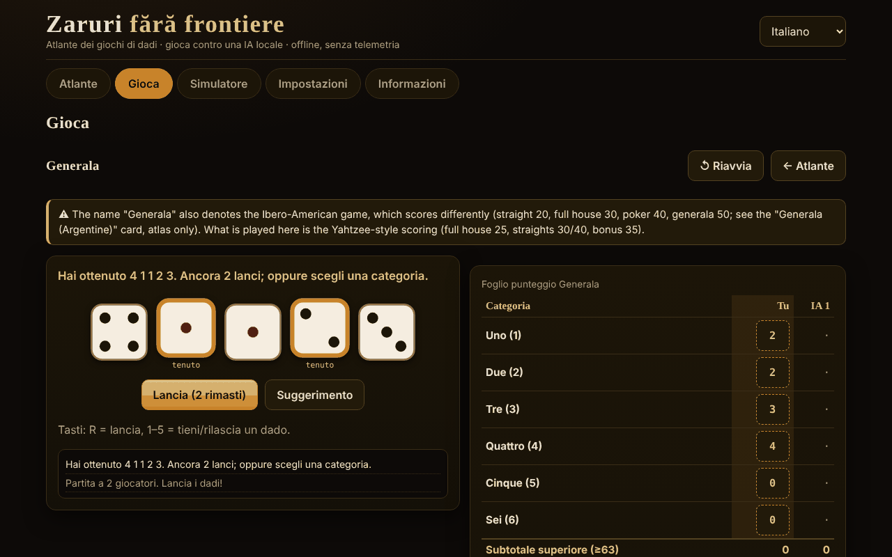

# Zaruri fără frontiere

[English](README.md) · [Română](README.ro.md) · [Français](README.fr.md) · **Italiano** · [Español](README.es.md) · [Português](README.pt.md) · [Deutsch](README.de.md) · [Magyar](README.hu.md)

**Versione:** 1.2.1 · **Ultimo aggiornamento:** 2026-10-19

Lingue dell'interfaccia: **Română, English, Français, Italiano, Español, Português (PT), Deutsch, Magyar**

Atlante di giochi di dadi e partite contro un'IA locale — un unico file HTML, offline, senza dipendenze e senza telemetria.

**Online:** https://chiuta.github.io/Zaruri-fara-frontiere/

## Che cos'è

Un atlante di 26 schede di giochi di dadi, di cui **12 sono giocabili** contro un'IA locale (un motore didattico, non un modello linguistico) e 14 sono **solo nell'atlante** (descritte, non implementate). In più un simulatore di dadi generico. Tutto gira nel browser, da un unico `index.html`.

Questa **non è un'applicazione di gioco d'azzardo con denaro**: non ci sono poste reali, depositi o vincite. Il Craps usa solo gettoni virtuali.

## Funzioni (verificate nel codice e nei test)

- **Dadi**: `crypto.getRandomValues` con *rejection sampling* (senza bias del modulo). Facoltativamente, un *seed* (mulberry32) per partite riproducibili — in tal caso i dadi sono prevedibili, e l'app lo dice.
- **Dadi SVG grandi**, con punti e `aria-label` con il valore; l'animazione del lancio rispetta `prefers-reduced-motion` e un interruttore nelle Impostazioni.
- **Interfaccia in 8 lingue** (RO/EN/FR/IT/ES/PT/DE/HU) con selettore e rilevamento automatico da `navigator.languages`; `lang` aggiornato dinamicamente.
- **Tastiera**: tutte le azioni hanno pulsanti accessibili con Tab/Invio/Spazio; scorciatoie per i dadi (R = lancia, 1–5 = tieni) dove applicabile; aree di tocco ≥ 44 px; focus visibile; messaggi `aria-live`; layout senza scorrimento orizzontale a 390 px.
- **Statistiche locali** (vittorie/sconfitte/pareggi) in `localStorage`, solo se disponibile; si possono cancellare dalle Impostazioni.
- **Simulatore**: notazione `NdM`, `+/−`, costanti (fino a 1 000 000 000), `d%`, tieni/scarta i più alti/più bassi (`kh/kl/dh/dl`), limiti di 100 dadi / 1000 facce / 12 termini, cronologia (gli ultimi 50 lanci, conservata in locale). La distribuzione esatta viene calcolata solo per espressioni con intervallo ≤ 400 valori e costo ridotto (altrimenti compare una nota, la scheda non si blocca).
- **Analisi nel simulatore** (espressioni con distribuzione esatta): interrogazione di probabilità `P(S ≥ / ≤ / = v)` calcolata dalla distribuzione esatta (con un rapporto approssimativo 1 : x); pulsante «Simula 10 000 lanci» che confronta la media e le frequenze osservate con quelle esatte; «Copia la cronologia».
- **Plurali** corretti nei messaggi con numeri (ad es. «1 lancio» / «2 lanci») nelle 8 lingue.

## Varianti

| Variante | Giocabile? | ⚠ Approssimazioni / cosa manca |
|---|---|---|
| Generala (regole di tipo «Yahtzee®», marchio Hasbro) | sì, 2–4 giocatori | ⚠ Il nome «Generala» designa anche il gioco iberoamericano, con un altro punteggio (scala 20, full 30, poker 40, generala 50; scheda separata, solo nell'atlante). Qui: punteggio di tipo Yahtzee, bonus 35 a ≥ 63, bonus 100 solo se «Generala» = 50, regola ufficiale del jolly (forzato). Nessuna variante regionale. |
| 10000 (Farkle) | sì, 2–4 | Non esistono regole canoniche: preset «classico» (solo 1, 5, tre uguali; 4/5/6 uguali raddoppiano), soglia di ingresso e obiettivo configurabili, turno finale facoltativo. |
| Greed (variante) | sì | Solo il preset «combinazioni» (scala 1–6 e tre coppie = 1500); NON è una regola canonica di «Greed». |
| Perudo (dado del bugiardo) | sì, 2–5 | Scelte documentate: palifico solo con ≥ 3 giocatori, calza consentita, apertura del round con 1 (jolly) vietata (tranne palifico o un solo dado), chi perde apre il round successivo (dopo una «calza» apre chi l'ha dichiarata). |
| Dado del bugiardo (classico) | sì, 2–5 | La variante minima: senza jolly, senza calza, senza palifico. |
| Mia (Meyer) | sì, 2–4 | Regole casalinghe variabili; la variante «passi il bicchiere senza guardare» NON è implementata; dichiarazioni strettamente crescenti; una Mia contestata correttamente costa 2 vite. |
| Craps | sì, 1 giocatore | Pass / Don't pass / Come / Don't come e odds alle quote vere (limiti 1×, 2×, 3×, 5×, 10×, 3-4-5×). NON: Place, Field, Hardways, proposition bet; le puntate non si ritirano; gli odds su Come sono disattivati al «come-out»; 12 = pareggio su Don't. |
| Pig | sì | — (IA ottimale calcolata in locale, Pig a 100) |
| Big Pig | sì | Variante: un solo 1 = perdi il turno; doppio 1 = 25; altri doppi = doppio della somma. Non esiste una variante canonica. |
| Chicago | sì, 2–4 | Solo la variante semplice (11 round, obiettivo 2–12); nessuna versione con poste. Puro gioco di fortuna. |
| Shut the box | sì, tu contro l'IA | Un round = un turno; 3/5/7 round, si sommano le tessere rimaste; regola del «un dado» facoltativa/obbligatoria/mai. |
| Dadi poker | sì, tu contro l'IA | Mani 9–A, fino a 3 lanci; spareggio per tipo, poi per le facce dei gruppi; pari = pareggio. |
| Generala argentina, Yacht, Yatzy | solo nell'atlante | Valori senza fonte univoca; le regole variano. |
| Hazard, Sic Bo, Cee-lo, Ship-Captain-Crew, Crown & Anchor, Bunco, Barbut, Skunk, Pass the Pigs, dadi non transitivi, dadi da gioco di ruolo | solo nell'atlante | Riassunti; «Pass the Pigs» non si può simulare senza probabilità misurate; il Barbut ha regole incerte. |

## IA — che cos'è e che cosa non è

Non è un modello linguistico. Sono motori didattici, ciascuno descritto onestamente nella scheda del gioco:

- **Generala**: expectimax esatto sui 252 multiinsiemi di dadi e sulle tabelle di rilancio, più una stima semplice del «costo opportunità» della categoria (parametri regolati empiricamente: punteggio medio ≈ 241,5 in 300+ partite IA contro IA; non è ottimale).
- **10000/Greed**: euristica (la probabilità di Farkle e il guadagno atteso per enumerazione, incassa a soglie fisse). Non è ottimale.
- **Perudo/Dado del bugiardo**: probabilità binomiali dai propri dadi + numero totale di dadi + storia delle puntate, decisione per valore atteso. Nei test non sceglie mai «calza».
- **Mia**: euristica semplice; può mentire.
- **Pig/Big Pig**: politica ottimale calcolata nel browser per iterazione dei valori (alcuni secondi al primo avvio, con barra di avanzamento).
- **Shut the box**: programmazione dinamica esatta sui 512 stati delle tessere.
- **Dadi poker**: politica esatta tramite tabelle di transizione.
- **Chicago/Craps**: nessuna IA decisionale (fortuna).

**L'IA non bara.** Non vede i dadi nascosti degli altri (Perudo, Mia) e non conosce i lanci futuri. Per il Perudo esiste un test che permuta i dadi degli avversari e verifica che la decisione dell'IA resti identica. Non c'è una barra di «difficoltà»: non esistono livelli.

## Guida all'uso

1. Apri `index.html` (doppio clic o dalla pagina Online).
2. In **Atlante** sfogli le schede; i filtri e la ricerca restringono l'elenco. «Regole e note» si apre sulla scheda.
3. Premi **▶ Gioca** su una scheda giocabile (o scegli dalla scheda **Gioca**), imposta le opzioni e premi **Inizia**.
4. Nel tuo turno: lancia (R), scegli i dadi da tenere (1–5) e la categoria/azione. Un messaggio `aria-live` annuncia quanto è successo.
5. **Simulatore**: scrivi `2d6+3` e premi Lancia.
6. **Impostazioni**: animazione, seed (facoltativo), cancellazione dei dati locali.

Nota: cambiare lingua durante una partita **riavvia** la partita in corso.

## Lingue

Gli elementi dell'interfaccia (pulsanti, messaggi, menu, le regole brevi di ogni gioco) sono in tutte e 8 le lingue. **I testi lunghi dell'atlante (regole, origini, note ⚠, descrizione dell'IA, sezione Informazioni) esistono solo in rumeno e inglese**; in FR/IT/ES/PT/DE/HU il testo viene mostrato in inglese, contrassegnato `lang="en"`, con una discreta nota «testo in inglese». Un test verifica la parità delle chiavi i18n e delle sostituzioni `{…}` tra le 8 lingue.

## Privacy e rete

- Zero richieste di rete: CSP rigorosa `default-src 'none'`, `script-src` solo tramite hash sha256 (3 script inline), `style-src 'unsafe-inline'` (necessario per gli stili impostati dall'interfaccia), `img-src data:`, senza `connect-src`. Non ci sono `fetch`, `eval` o `innerHTML` (verificato cercando nel file consegnato).
- `localStorage` solo dentro `try/catch` (lingua, animazione, seed, statistiche, cronologia del simulatore — gli ultimi 50 lanci; si cancella dalle Impostazioni); l'app funziona anche senza.
- Gli unici link esterni sono nel piè di pagina/angolo della pagina: Buy Me a Coffee e GitHub, con `rel="noopener"`.
- Nessun account, nessun cookie, nessuna analisi.

## Limiti e avvertenze

- Non è un gioco d'azzardo con denaro; i gettoni del Craps sono virtuali.
- I nomi commerciali citati (Yahtzee®, Perudo®, Pass the Pigs®, Kniffel®) appartengono ai rispettivi proprietari; l'app non è affiliata. I titoli usano nomi tradizionali/generici; «Perudo» e «Farkle» sono però usati anche commercialmente da altri produttori (mantenerli nel titolo è una decisione dell'autore).
- Le varianti contrassegnate ⚠ sono approssimazioni o scelte documentate, non «la regola ufficiale».
- Pig: il calcolo della politica ottimale richiede alcuni secondi sui telefoni lenti.
- Non implementato: simboli alternativi per il daltonismo (i dadi usano punti, non colori, per il valore), modalità «mostra i dadi dell'IA».
- I test automatici sono nello spazio di lavoro dell'autore, non nel pacchetto (vedi il rapporto).

## Fonti

- Regole dello Yahtzee/Generala (categorie, bonus 35, bonus 100, regola ufficiale del jolly): Wikipedia, «Yahtzee» (verificato in questa sessione) e le regole pubblicate dal produttore (a memoria; non confrontate con il testo ufficiale).
- Pig ottimale (≈ 53,06% per il primo giocatore a 100): l'articolo «Optimal Play of the Dice Game Pig» (The UMAP Journal, 2004); il valore è stato riprodotto con un calcolo proprio nei test (entro una tolleranza di 0,0006).
- Dado del bugiardo / Perudo, Mia, Pig, Craps, Shut the box, Farkle: i rispettivi articoli di Wikipedia e descrizioni di regole di gioco; le regole esatte variano e le varianti scelte sono elencate sopra.
- Craps: la probabilità della pass-line 244/495 verificata con calcolo esatto e simulazione; quote vere 2:1 / 3:2 / 6:5 (e 1:2 / 2:3 / 5:6 per il «lay») e 3-4-5× secondo Wikipedia, «Craps».
- Perudo/Dudo (ordine delle puntate, 1 come jolly, palifico, calza, apertura): Wikipedia, «Dudo»; regolamento del Perudo pubblicato su rulespal.com.
- Mia: Wikipedia, «Mia (game)» (ordine 31 … 65, 11 … 66, 21; Mia contestata correttamente = 2 vite). Qui la dichiarazione deve essere *strettamente* maggiore della precedente (alcune fonti accettano «uguale o maggiore»).
- Big Pig (un solo 1 = perdi il turno, doppio 1 = 25, altri doppi = doppio della somma): descrizione didattica usata nei corsi di programmazione; non esiste una regola canonica.
- Generala iberoamericana (valori citati nell'atlante): Wikipedia, «Generala».
- Audit indipendente: le regole sopra riportate sono state rilette da un secondo agente;.

## Esecuzione locale

Non richiede build, server né installazione: apri `index.html` in un browser moderno.

## Cronologia / Changelog

### 1.1.0 — 2026-10-14
- Copia di sicurezza ed etichettatura dei dati (fff-kit).

### 12 ottobre 2026 — versione 1.0.0
- 1.0.0 — 2026-10-12: la versione e la data dell'ultimo aggiornamento sono mostrate nell'app

### 11 ottobre 2026 (terzo passaggio)
- Simulatore: il risultato dettagliato è privo di ambiguità (`4d6kh3 [2, 4, 3, 4] → [3, 4, 4] = 11  ·  + 2`; le costanti non compaiono più come «= 2»); la cronologia dei lanci viene conservata in locale tra le sessioni (gli ultimi 50, convalidata alla lettura, cancellata da Impostazioni → dati). CSP: hash ricalcolati.

### 11 ottobre 2026 (secondo passaggio)
- Simulatore: probabilità `P(S ≥/≤/= v)` dalla distribuzione esatta, simulazione di 10 000 lanci con confronto osservato/esatto, copia della cronologia (nuovi testi in 7 lingue); titoli della distribuzione passati a `h3` (ordine corretto dei titoli); CSP: hash ricalcolati.

### 11 ottobre 2026
- Accessibilità: il widget di sostegno Buy Me a Coffee ha ora un ruolo di punto di riferimento (`complementary`); axe-core segnala 0 violazioni a 1280 e 360 px. Gli script e gli hash CSP non sono stati modificati.

## Licenza

MIT — vedi il file LICENSE.

## Autore

Alexandru-Ionuț Chiuță (Alexio).

## Riepilogo

Un atlante di giochi di dadi offline in un unico file, con 26 schede; 12 sono giocabili contro un'IA locale non LLM (Generala, 10000/Farkle, variante Greed, Perudo, dado del bugiardo classico, Mia, Craps con gettoni virtuali, Pig, Big Pig, Chicago, Shut the box, dadi poker) e le altre sono solo nell'atlante. I dadi usano `crypto.getRandomValues` con rejection sampling (seed facoltativo). Nessuna rete (CSP rigorosa), nessuna telemetria, non è gioco d'azzardo con denaro. Interfaccia in 8 lingue; i testi lunghi delle regole esistono solo in rumeno e inglese (le altre lingue mostrano l'inglese). L'IA non bara. Le varianti contrassegnate ⚠ sono approssimazioni o scelte casalinghe documentate. Licenza: MIT (vedi LICENSE).
