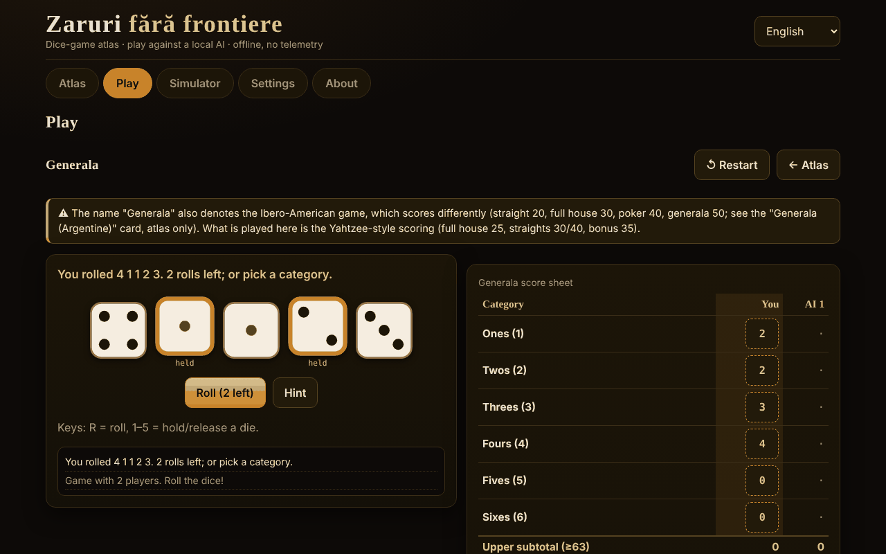

# Zaruri fără frontiere

**English** · [Română](README.ro.md) · [Français](README.fr.md) · [Italiano](README.it.md) · [Español](README.es.md) · [Português](README.pt.md) · [Deutsch](README.de.md) · [Magyar](README.hu.md)

**Version:** 1.2.5 · **Last updated:** 2026-10-22

Interface languages: **Română, English, Français, Italiano, Español, Português (PT), Deutsch, Magyar**

An atlas of dice games and matches against a local AI — a single HTML file, offline, with no dependencies and no telemetry.

**Live:** https://chiuta.github.io/Zaruri-fara-frontiere/

## What it is

An atlas of 26 dice-game entries, of which **12 are playable** against a local AI (a didactic engine, not a language model) and 14 are **atlas-only** (described, not implemented). Plus a generic dice simulator. Everything runs in the browser, from a single `index.html`.

This is **not a real-money gambling app**: there are no real stakes, deposits or winnings. Craps uses virtual chips only.

## Features (verified in the code and in tests)

- **Dice**: `crypto.getRandomValues` with *rejection sampling* (no modulo bias). Optionally, a *seed* (mulberry32) for reproducible games — in which case the dice are predictable, and the app says so.
- **Large SVG dice**, with pips and an `aria-label` with the value; the rolling animation respects `prefers-reduced-motion` and a switch in Settings.
- **Interface in 8 languages** (RO/EN/FR/IT/ES/PT/DE/HU) with a switch and autodetection from `navigator.languages`; `lang` updated dynamically.
- **Keyboard**: all actions have buttons reachable with Tab/Enter/Space; shortcuts for dice (R = roll, 1–5 = keep) where applicable; touch targets ≥ 44 px; visible focus; `aria-live` messages; layout without horizontal scrolling at 390 px.
- **Local statistics** (wins/losses/draws) in `localStorage`, only if available; they can be deleted from Settings.
- **Simulator**: `NdM` notation, `+/−`, constants (up to 1,000,000,000), `d%`, keep/drop highest/lowest (`kh/kl/dh/dl`), limits of 100 dice / 1000 faces / 12 terms, history (the last 50 rolls, kept locally). The exact distribution is computed only for expressions with a range ≤ 400 values and low cost (otherwise a note is shown, the tab is not blocked).
- **Analysis in the simulator** (expressions with an exact distribution): probability query `P(S ≥ / ≤ / = v)` computed from the exact distribution (with an approximate 1 : x ratio); a "Simulate 10,000 rolls" button that compares the observed mean and frequencies with the exact ones; "Copy history".
- Correct **pluralisation** in messages with numbers (e.g. "1 roll" / "2 rolls") in the 8 languages.

## Variants

| Variant | Playable? | ⚠ Approximations / what is missing |
|---|---|---|
| Generala (rules of the "Yahtzee®" type, a Hasbro trademark) | yes, 2–4 players | ⚠ The name "Generala" also designates the Ibero-American game, with different scoring (straight 20, full house 30, poker 40, generala 50; a separate entry, atlas-only). Here: Yahtzee-type scoring, 35 bonus at ≥ 63, 100 bonus only if "Generala" = 50, official joker rule (forced). No regional variants. |
| 10000 (Farkle) | yes, 2–4 | There are no canonical rules: "classic" preset (only 1s, 5s, three of a kind; 4/5/6 of a kind double), configurable entry threshold and target, optional final turn. |
| Greed (variant) | yes | Only the "combinations" preset (straight 1–6 and three pairs = 1500); this is NOT a canonical "Greed" rule. |
| Perudo (liar's dice) | yes, 2–5 | Documented choices: palifico only with ≥ 3 players, calza allowed, opening a round with 1s (jokers) forbidden (except palifico or a single die), the loser opens the next round (after a "calza" the one who called it opens). |
| Liar's dice (classic) | yes, 2–5 | The minimal variant: no jokers, no calza, no palifico. |
| Mia (Meyer) | yes, 2–4 | House rules vary; the variant "you pass the unseen cup" is NOT implemented; strictly increasing announcements; a correctly challenged Mia costs 2 lives. |
| Craps | yes, 1 player | Pass / Don't pass / Come / Don't come and odds at true odds (limits 1×, 2×, 3×, 5×, 10×, 3-4-5×). NOT: Place, Field, Hardways, proposition bets; bets cannot be taken down; Come odds are off on the come-out; 12 = push on Don't. |
| Pig | yes | — (optimal AI computed locally, Pig to 100) |
| Big Pig | yes | Variant: a single 1 = you lose the turn; double 1 = 25; other doubles = double the sum. There is no canonical variant. |
| Chicago | yes, 2–4 | Only the simple variant (11 rounds, target 2–12); no versions with stakes. Pure game of chance. |
| Shut the box | yes, you against the AI | A round = one turn; 3/5/7 rounds, the remaining tiles are added up; the "one die" rule optional/mandatory/never. |
| Poker dice | yes, you against the AI | Hands 9–A, up to 3 rolls; tie-break by type, then by the faces of the groups; equal = draw. |
| Argentine Generala, Yacht, Yatzy | atlas-only | Values not uniquely sourced; the rules vary. |
| Hazard, Sic Bo, Cee-lo, Ship-Captain-Crew, Crown & Anchor, Bunco, Barbut, Skunk, Pass the Pigs, nontransitive dice, role-playing dice | atlas-only | Summaries; "Pass the Pigs" cannot be simulated without measured probabilities; Barbut has uncertain rules. |

## AI — what it is and what it is not

It is not a language model. They are didactic engines, each honestly described in the game's entry:

- **Generala**: exact expectimax over the 252 dice multisets and the re-roll tables, plus a simple estimate of the category's "opportunity cost" (empirically tuned parameters: average score ≈ 241.5 over 300+ AI vs AI games; it is not optimal).
- **10000/Greed**: heuristic (the chance of a Farkle and the expected gain by enumeration, banks at fixed thresholds). It is not optimal.
- **Perudo/Liar's dice**: binomial probabilities from its own dice + the total number of dice + the bidding history, decision by expected value. In tests it never chooses "calza".
- **Mia**: simple heuristic; it can lie.
- **Pig/Big Pig**: optimal policy computed in the browser by value iteration (a few seconds on first start, with a progress bar).
- **Shut the box**: exact dynamic programming over the 512 tile states.
- **Poker dice**: exact policy through transition tables.
- **Chicago/Craps**: no decision AI (luck).

**The AI does not cheat.** It does not see the hidden dice of others (Perudo, Mia) and does not know future rolls. For Perudo there is a test that permutes the opponents' dice and checks that the AI's decision stays identical. There is no "difficulty" bar: there are no levels.

## User guide

1. Open `index.html` (double-click or from the Live page).
2. In **Atlas** you browse the entries; the filters and search narrow the list. "Rules and notes" opens on the entry.
3. Press **▶ Play** on a playable entry (or choose from the **Play** tab), set the options and press **Start**.
4. On your turn: roll (R), choose the dice to keep (1–5) and the category/action. An `aria-live` message announces what happened.
5. **Simulator**: type `2d6+3` and press Roll.
6. **Settings**: animation, seed (optional), deleting local data.

Note: changing the language during a game **restarts** the current game.

## Languages

The interface elements (buttons, messages, menus, the short rules of each game) are in all 8 languages. **The long texts in the atlas (rules, origins, ⚠ notes, the AI description, the About section) exist only in Romanian and English**; in FR/IT/ES/PT/DE/HU the text is displayed in English, marked `lang="en"`, with a discreet "text in English" note. A test checks the parity of the i18n keys and of the `{…}` substitutions across the 8 languages.

## Privacy and network

- Zero network requests: strict CSP `default-src 'none'`, `script-src` only by sha256 hash (3 inline scripts), `style-src 'unsafe-inline'` (needed for styles set from the interface), `img-src data:`, no `connect-src`. There is no `fetch`, `eval` or `innerHTML` (checked by searching the delivered file).
- `localStorage` only inside `try/catch` (language, animation, seed, statistics, the simulator history — the last 50 rolls; deleted from Settings); the app also works without it.
- The only external links are in the footer/corner of the page: Buy Me a Coffee and GitHub, with `rel="noopener"`.
- No account, no cookies, no analytics.

## Limits and warnings

- It is not a real-money gambling game; the chips in Craps are virtual.
- The commercial names cited (Yahtzee®, Perudo®, Pass the Pigs®, Kniffel®) belong to their owners; the app is not affiliated. The titles use traditional/generic names; "Perudo" and "Farkle" are, however, also used commercially by other producers (keeping them in the title is the author's decision).
- Variants marked ⚠ are approximations or documented choices, not "the official rule".
- Pig: computing the optimal policy takes a few seconds on slow phones.
- Not implemented: alternative symbols for colour-blindness (the dice use pips, not colours, for the value), a "show the AI's dice" mode.
- The automated tests are in the author's workspace, not in the package (see the report).

## Sources

- Yahtzee/Generala rules (categories, 35 bonus, 100 bonus, official joker rule): Wikipedia, "Yahtzee" (checked in this session) and the rules published by the manufacturer (from memory; not compared with the official text).
- Optimal Pig (≈ 53.06% for the first player at 100): the paper "Optimal Play of the Dice Game Pig" (The UMAP Journal, 2004); the value was reproduced by our own computation in the tests (within a tolerance of 0.0006).
- Liar's dice / Perudo, Mia, Pig, Craps, Shut the box, Farkle: the respective Wikipedia articles and game-rule descriptions; the exact rules vary and the chosen variants are listed above.
- Craps: the pass-line probability 244/495 verified by exact calculation and simulation; true odds 2:1 / 3:2 / 6:5 (and 1:2 / 2:3 / 5:6 for "lay") and 3-4-5× according to Wikipedia, "Craps".
- Perudo/Dudo (order of bids, 1s as jokers, palifico, calza, opening): Wikipedia, "Dudo"; Perudo rules published on rulespal.com.
- Mia: Wikipedia, "Mia (game)" (order 31 … 65, 11 … 66, 21; a correctly challenged Mia = 2 lives). Here the announcement must be *strictly* greater than the previous one (some sources accept "equal or greater").
- Big Pig (a single 1 = you lose the turn, double 1 = 25, other doubles = double the sum): a didactic description used in programming courses; there is no canonical rule.
- Ibero-American Generala (values cited in the atlas): Wikipedia, "Generala".
- Independent audit: the rules above were re-read by a second agent;.

## Running locally

It needs no build, server or installation: open `index.html` in a modern browser.

## History / Changelog

### 1.2.5 — 2026-10-22
- fff-kit 1.1.4: touch targets and minimum text size

### 1.2.4 — 2026-10-22
- fff-kit 1.1.2: PBKDF2 600,000 iterations, anti-clickjacking protection.

### 1.2.3 — 2026-10-22
- All remaining English-only card subtitles (Poker dice, Greed (variant), Liar’s dice (classic), Non-transitive dice, Generala (Argentine), Perudo, 10000 / Farkle, Shut the box, Pass the Pigs) are now in the language dictionary for all 8 languages.

### 1.2.2 — 2026-10-22
- Localized the English-only card labels “Generala (five-dice game)” and “Role-playing dice (d4–d100)” in all 8 languages; the English UI now shows English card titles.

### 1.1.0 — 2026-10-14
- Backup and data labelling (fff-kit).

### 12 October 2026 — version 1.0.0
- 1.0.0 — 2026-10-12: the version and the date of the last update are shown in the app

### 11 October 2026 (third pass)
- Simulator: the detailed result is unambiguous (`4d6kh3 [2, 4, 3, 4] → [3, 4, 4] = 11  ·  + 2`; constants no longer appear as "= 2"); the roll history is kept locally between sessions (the last 50, validated on reading, deleted from Settings → data). CSP: hashes recalculated.

### 11 October 2026 (second pass)
- Simulator: probability `P(S ≥/≤/= v)` from the exact distribution, simulation of 10,000 rolls with an observed/exact comparison, history copy (new texts in 7 languages); the distribution headings moved to `h3` (correct heading order); CSP: hashes recalculated.

### 11 October 2026
- Accessibility: the Buy Me a Coffee support widget now has a landmark role (`complementary`); axe-core reports 0 violations at 1280 and 360 px. The scripts and the CSP hashes were not modified.

## License

MIT — see the LICENSE file.

## Author

Alexandru-Ionuț Chiuță (Alexio).

## Summary

A single-file, offline dice-game atlas with 26 entries; 12 are playable against a local, non-LLM AI (Generala, 10000/Farkle, Greed variant, Perudo, classic Liar's dice, Mia, Craps with virtual chips, Pig, Big Pig, Chicago, Shut the box, Poker dice) and the rest are atlas-only. Dice use `crypto.getRandomValues` with rejection sampling (optional seed). No network (strict CSP), no telemetry, not real-money gambling. UI in 8 languages; long rule texts exist in Romanian and English only (other languages show English). The AI does not cheat. Variants marked ⚠ are approximations or documented house choices. Licence: MIT (see LICENSE).
