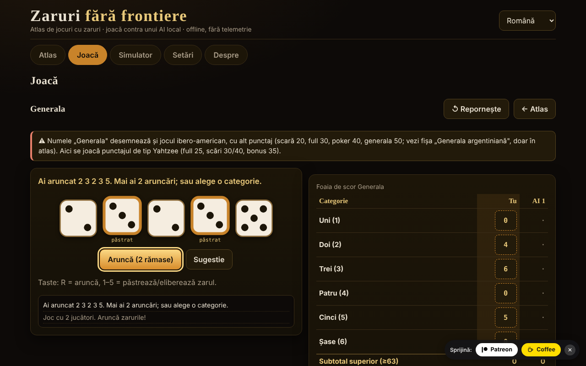

# Zaruri fără frontiere

Atlas de jocuri cu zaruri și partide contra unui AI local — un singur fișier HTML, offline, fără dependențe, fără telemetrie.

**Live:** https://chiuta.github.io/Zaruri-fara-frontiere/

**Ultima actualizare:** 11 octombrie 2026

## Ce este

Un atlas de 26 de fișe de jocuri cu zaruri, din care **12 sunt jucabile** contra unui AI local (motor didactic, nu model de limbaj) și 14 sunt **doar în atlas** (descrise, nu implementate). Plus un simulator de zaruri generic. Totul rulează în browser, dintr-un singur `index.html`.

Aceasta **nu este o aplicație de jocuri de noroc pe bani**: nu există mize reale, depuneri sau câștiguri. Craps folosește doar jetoane virtuale.

## Funcții (verificate în cod și în teste)

- **Zaruri**: `crypto.getRandomValues` cu *rejection sampling* (fără bias modulo). Opțional, un *seed* (mulberry32) pentru partide reproductibile — atunci zarurile sunt previzibile, iar aplicația o spune.
- **Zaruri SVG mari**, cu puncte și `aria-label` cu valoarea; animația de aruncare respectă `prefers-reduced-motion` și un comutator din Setări.
- **Interfață în 7 limbi** (RO/EN/FR/IT/ES/PT/DE) cu comutator și autodetecție din `navigator.languages`; `lang` actualizat dinamic.
- **Tastatură**: toate acțiunile au butoane accesibile cu Tab/Enter/Spațiu; scurtături pentru zaruri (R = aruncă, 1–5 = păstrează) unde se aplică; zone de atingere ≥ 44 px; focus vizibil; mesaje `aria-live`; aspect fără defilare orizontală la 390 px.
- **Statistici locale** (victorii/înfrângeri/remize) în `localStorage`, doar dacă e disponibil; se pot șterge din Setări.
- **Simulator**: notație `NdM`, `+/−`, constante (până la 1 000 000 000), `d%`, păstrează/elimină cele mai mari/mici (`kh/kl/dh/dl`), limite 100 zaruri / 1000 fețe / 12 termeni, istoric. Distribuția exactă se calculează doar pentru expresii cu interval ≤ 400 de valori și cost redus (altfel se afișează o notă, nu se blochează fila).
- **Analiză în simulator** (expresii cu distribuție exactă): interogare de probabilitate `P(S ≥ / ≤ / = v)` calculată din distribuția exactă (cu raport aproximativ 1 : x); buton „Simulează 10 000 aruncări” care compară media și frecvențele observate cu cele exacte; „Copiază istoricul”.
- **Pluralizare** corectă în mesajele cu numere (ex. „1 aruncare” / „2 aruncări”) în cele 7 limbi.

## Variante

| Variantă | Jucabil? | ⚠ Aproximări / ce lipsește |
|---|---|---|
| Generala (reguli de tip „Yahtzee®", marcă Hasbro) | da, 2–4 jucători | ⚠ Numele „Generala" desemnează și jocul ibero-american, cu alt punctaj (scară 20, full 30, poker 40, generala 50; fișă separată, doar în atlas). Aici: punctaj de tip Yahtzee, bonus 35 la ≥ 63, bonus 100 doar dacă „Generala" = 50, regula jokerului oficială (forțată). Fără variante regionale. |
| 10000 (Farkle) | da, 2–4 | Nu există reguli canonice: preset „clasic" (doar 1, 5, trei egale; 4/5/6 egale dublează), prag de intrare și țintă configurabile, tură finală opțională. |
| Greed (variantă) | da | Doar presetul „combinații" (scară 1–6 și trei perechi = 1500); NU este o regulă canonică „Greed". |
| Perudo (zarul mincinos) | da, 2–5 | Alegeri documentate: palifico doar cu ≥ 3 jucători, calza permisă, deschiderea rundei cu 1-uri (jokeri) interzisă (exceptând palifico sau un singur zar), pierzătorul deschide runda următoare (după o „calza" deschide cel care a spus-o). |
| Zarul mincinos (clasic) | da, 2–5 | Varianta minimă: fără jokeri, fără calza, fără palifico. |
| Mia (Meyer) | da, 2–4 | Reguli casnice variabile; varianta „pasezi cupa nevăzută" NU este implementată; anunțuri strict crescătoare; Mia contestată corect costă 2 vieți. |
| Craps | da, 1 jucător | Pass / Don't pass / Come / Don't come și odds la cote adevărate (limite 1×, 2×, 3×, 5×, 10×, 3-4-5×). NU: Place, Field, Hardways, propoziții; pariurile nu se retrag; odds la Come oprite la „come-out"; 12 = egal la Don't. |
| Pig | da | — (AI optim calculat local, Pig la 100) |
| Big Pig | da | Variantă: un singur 1 = pierzi tura; dublu 1 = 25; alte duble = dublul sumei. Nu există o variantă canonică. |
| Chicago | da, 2–4 | Doar varianta simplă (11 runde, ținta 2–12); fără versiuni cu mize. Joc de noroc pur. |
| Tăbliță (Shut the box) | da, tu contra AI | Rundă = o tură; 3/5/7 runde, se adună plăcuțele rămase; regula „un zar" optională/obligatorie/niciodată. |
| Zaruri de poker | da, tu contra AI | Mâini 9–A, până la 3 aruncări; departajare pe tip, apoi pe fețele grupurilor; egal = remiză. |
| Generala argentiniană, Yacht, Yatzy | doar în atlas | Valori nesursate unic; regulile variază. |
| Hazard, Sic Bo, Cee-lo, Ship-Captain-Crew, Crown & Anchor, Bunco, Barbut, Skunk, Pass the Pigs, zaruri neranzitive, zaruri de rol | doar în atlas | Rezumate; „Pass the Pigs" nu poate fi simulat fără probabilități măsurate; Barbut are reguli nesigure. |

## AI — ce este și ce nu este

Nu este un model de limbaj. Sunt motoare didactice, fiecare descris onest în fișa jocului:

- **Generala**: expectimax exact peste cele 252 de multiseturi de zaruri și tabelele de re-aruncare, plus o estimare simplă a „costului de oportunitate" al categoriei (parametri reglați empiric: scor mediu ≈ 241,5 în 300+ partide AI vs AI; nu este optim).
- **10000/Greed**: euristică (șansa de Farkle și câștigul așteptat prin enumerare, depune la praguri fixe). Nu este optim.
- **Perudo/Zarul mincinos**: probabilități binomiale din propriile zaruri + numărul total de zaruri + istoricul licitațiilor, decizie după valoarea așteptată. În teste nu alege niciodată „calza".
- **Mia**: heuristică simplă; poate minți.
- **Pig/Big Pig**: politică optimă calculată în browser prin iterație de valori (câteva secunde la prima pornire, cu bară de progres).
- **Tăbliță**: programare dinamică exactă peste cele 512 stări ale plăcuțelor.
- **Zaruri de poker**: politică exactă prin tabele de tranziție.
- **Chicago/Craps**: fără AI de decizie (noroc).

**AI-ul nu trișează.** Nu vede zarurile ascunse ale altora (Perudo, Mia) și nu cunoaște viitoarele aruncări. Pentru Perudo există un test care permută zarurile adversarilor și verifică că decizia AI-ului rămâne identică. Nu există bară de „dificultate": nu există niveluri.

## Manual de utilizare

1. Deschide `index.html` (dublu clic sau din pagina Live).
2. În **Atlas** răsfoiești fișele; filtrele și căutarea restrâng lista. „Reguli și note" se deschide pe fișă.
3. Apasă **▶ Joacă** pe o fișă jucabilă (sau alege din fila **Joacă**), setează opțiunile și apasă **Începe**.
4. Pe tura ta: aruncă (R), alege zarurile de păstrat (1–5) și categoria/acțiunea. Un mesaj `aria-live` anunță ce s-a întâmplat.
5. **Simulator**: scrie `2d6+3` și apasă Aruncă.
6. **Setări**: animație, seed (opțional), ștergerea datelor locale.

Notă: schimbarea limbii în timpul unui joc **repornește** jocul curent.

## Limbi

Elementele de interfață (butoane, mesaje, meniuri, regulile scurte din fiecare joc) sunt în toate cele 7 limbi. **Textele lungi din atlas (reguli, origini, note ⚠, descrierea AI, secțiunea Despre) există doar în română și engleză**; în FR/IT/ES/PT/DE se afișează textul în engleză, marcat `lang="en"`, cu o notă discretă „text în engleză". Un test verifică paritatea cheilor i18n și a substituțiilor `{…}` între cele 7 limbi.

## Confidențialitate și rețea

- Zero cereri de rețea: CSP strict `default-src 'none'`, `script-src` doar prin hash sha256 (3 scripturi inline), `style-src 'unsafe-inline'` (necesar pentru stilurile setate din interfață), `img-src data:`, fără `connect-src`. Nu există `fetch`, `eval` sau `innerHTML` (verificat prin căutare în fișierul livrat).
- `localStorage` doar în `try/catch` (limbă, animație, seed, statistici); aplicația merge și fără el.
- Singurele legături externe sunt în subsol/colțul paginii: Patreon, Buy Me a Coffee și GitHub, cu `rel="noopener"`.
- Fără cont, fără cookie-uri, fără analiză.

## Limite și avertismente

- Nu este joc de noroc pe bani; jetoanele din Craps sunt virtuale.
- Numele comerciale citate (Yahtzee®, Perudo®, Pass the Pigs®, Kniffel®) aparțin proprietarilor; aplicația nu este afiliată. Titlurile folosesc nume tradiționale/generice; „Perudo” și „Farkle” sunt însă folosite și comercial de alți producători (păstrarea lor în titlu este o decizie a autorului).
- Variantele marcate ⚠ sunt aproximări sau alegeri documentate, nu „regula oficială".
- Pig: calculul politicii optime durează câteva secunde pe telefoane lente.
- Neimplementat: simboluri alternative pentru daltonism (zarurile folosesc puncte, nu culori, pentru valoare), mod „arată zarurile AI".
- Testele automate sunt în spațiul de lucru al autorului, nu în pachet (vezi raportul).

## Surse

- Reguli Yahtzee/Generala (categorii, bonus 35, bonus 100, regula jokerului oficială): Wikipedia, „Yahtzee" (verificat în această sesiune) și regulile publicate de producător (din memorie; nu comparate cu textul oficial).
- Pig optim (≈ 53,06% pentru primul jucător la 100): lucrarea „Optimal Play of the Dice Game Pig" (The UMAP Journal, 2004); valoarea a fost reprodusă prin calcul propriu în teste (în toleranță 0,0006).
- Liar's dice / Perudo, Mia, Pig, Craps, Shut the box, Farkle: articole Wikipedia respective și descrieri de reguli de joc; regulile exacte variază și variantele alese sunt listate mai sus.
- Craps: probabilitatea pass-line 244/495 verificată prin calcul exact și simulare; cotele adevărate 2:1 / 3:2 / 6:5 (și 1:2 / 2:3 / 5:6 pentru „lay") și 3-4-5× conform Wikipedia, „Craps".
- Perudo/Dudo (ordinea ofertelor, 1-uri jokeri, palifico, calza, deschidere): Wikipedia, „Dudo"; regulament Perudo publicat pe rulespal.com.
- Mia: Wikipedia, „Mia (game)" (ordinea 31 … 65, 11 … 66, 21; Mia contestată corect = 2 vieți). Aici anunțul trebuie să fie *strict* mai mare decât precedentul (unele surse acceptă „egal sau mai mare").
- Big Pig (singur 1 = pierzi tura, dublu 1 = 25, alte duble = dublul sumei): descriere didactică folosită la cursuri de programare; nu există o regulă canonică.
- Generala ibero-americană (valori citate în atlas): Wikipedia, „Generala".
- Audit independent: regulile de mai sus au fost recitite de un al doilea agent;.

## Rulare locală

Nu necesită build, server sau instalare: deschide `index.html` într-un browser modern.

## Istoric / Changelog

### 11 octombrie 2026 (a doua trecere)
- Simulator: probabilitate `P(S ≥/≤/= v)` din distribuția exactă, simulare de 10 000 aruncări cu comparație observat/exact, copiere istoric (texte noi în 7 limbi); titlurile distribuției trecute la `h3` (ordine corectă a titlurilor); CSP: hash-uri recalculate.

### 11 octombrie 2026
- Accesibilitate: widgetul de sprijin Patreon/Coffee are acum rol de reper (`complementary`); axe-core raportează 0 încălcări la 1280 și 360 px. Scripturile și hash-urile CSP nu au fost modificate.

## Licență

Nedeclarată — decizia autorului.

## Autor

Alexandru-Ionuț Chiuță (Alexio).

## English summary

A single-file, offline dice-game atlas with 26 entries; 12 are playable against a local, non-LLM AI (Generala, 10000/Farkle, Greed variant, Perudo, classic Liar's dice, Mia, Craps with virtual chips, Pig, Big Pig, Chicago, Shut the box, Poker dice) and the rest are atlas-only. Dice use `crypto.getRandomValues` with rejection sampling (optional seed). No network (strict CSP), no telemetry, not real-money gambling. UI in 7 languages; long rule texts exist in Romanian and English only (other languages show English). The AI does not cheat. Variants marked ⚠ are approximations or documented house choices. License: not declared — the author's decision.
