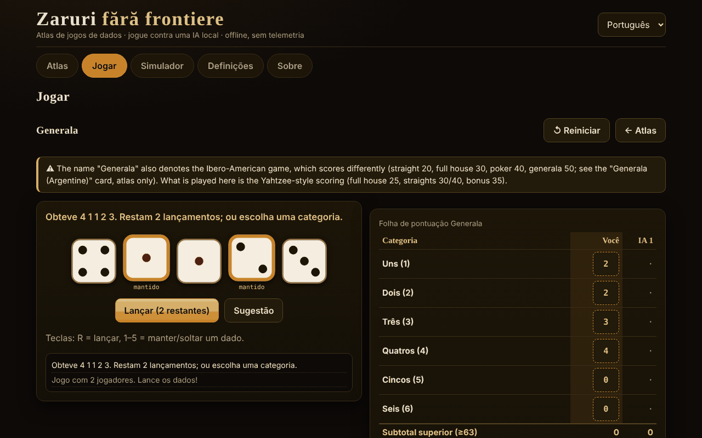

# Zaruri fără frontiere

[English](README.md) · [Română](README.ro.md) · [Français](README.fr.md) · [Italiano](README.it.md) · [Español](README.es.md) · **Português** · [Deutsch](README.de.md) · [Magyar](README.hu.md)

**Versão:** 1.2.0 · **Última atualização:** 2026-10-19

Idiomas da interface: **Română, English, Français, Italiano, Español, Português (PT), Deutsch, Magyar**

Atlas de jogos de dados e partidas contra uma IA local — um único ficheiro HTML, offline, sem dependências e sem telemetria.

**Online:** https://chiuta.github.io/Zaruri-fara-frontiere/

## O que é

Um atlas de 26 fichas de jogos de dados, das quais **12 são jogáveis** contra uma IA local (um motor didático, não um modelo de linguagem) e 14 são **apenas de atlas** (descritas, não implementadas). Além disso, um simulador de dados genérico. Tudo corre no navegador, a partir de um único `index.html`.

Esta **não é uma aplicação de jogos de azar a dinheiro**: não há apostas reais, depósitos nem ganhos. O Craps usa apenas fichas virtuais.

## Funcionalidades (verificadas no código e nos testes)

- **Dados**: `crypto.getRandomValues` com *rejection sampling* (sem enviesamento de módulo). Opcionalmente, uma *semente* (mulberry32) para partidas reproduzíveis — nesse caso os dados são previsíveis, e a aplicação di-lo.
- **Dados SVG grandes**, com pontos e `aria-label` com o valor; a animação do lançamento respeita `prefers-reduced-motion` e um interruptor nas Definições.
- **Interface em 8 idiomas** (RO/EN/FR/IT/ES/PT/DE/HU) com comutador e deteção automática a partir de `navigator.languages`; `lang` atualizado dinamicamente.
- **Teclado**: todas as ações têm botões acessíveis com Tab/Enter/Espaço; atalhos para os dados (R = lançar, 1–5 = manter) onde se aplique; áreas de toque ≥ 44 px; foco visível; mensagens `aria-live`; disposição sem deslocamento horizontal a 390 px.
- **Estatísticas locais** (vitórias/derrotas/empates) em `localStorage`, apenas se estiver disponível; podem ser apagadas nas Definições.
- **Simulador**: notação `NdM`, `+/−`, constantes (até 1 000 000 000), `d%`, manter/descartar os mais altos/mais baixos (`kh/kl/dh/dl`), limites de 100 dados / 1000 faces / 12 termos, histórico (os últimos 50 lançamentos, guardado localmente). A distribuição exata só é calculada para expressões com intervalo ≤ 400 valores e custo reduzido (caso contrário é mostrada uma nota, o separador não bloqueia).
- **Análise no simulador** (expressões com distribuição exata): consulta de probabilidade `P(S ≥ / ≤ / = v)` calculada a partir da distribuição exata (com uma razão aproximada 1 : x); botão «Simular 10 000 lançamentos» que compara a média e as frequências observadas com as exatas; «Copiar o histórico».
- **Plurais** corretos nas mensagens com números (p. ex. «1 lançamento» / «2 lançamentos») nos 8 idiomas.

## Variantes

| Variante | Jogável? | ⚠ Aproximações / o que falta |
|---|---|---|
| Generala (regras do tipo «Yahtzee®», marca da Hasbro) | sim, 2–4 jogadores | ⚠ O nome «Generala» designa também o jogo ibero-americano, com outra pontuação (sequência 20, full house 30, póquer 40, generala 50; ficha separada, apenas de atlas). Aqui: pontuação do tipo Yahtzee, bónus 35 com ≥ 63, bónus 100 só se «Generala» = 50, regra oficial do curinga (forçado). Sem variantes regionais. |
| 10000 (Farkle) | sim, 2–4 | Não existem regras canónicas: predefinição «clássica» (apenas 1, 5, trio; 4/5/6 iguais duplicam), limiar de entrada e objetivo configuráveis, volta final opcional. |
| Greed (variante) | sim | Apenas a predefinição «combinações» (sequência 1–6 e três pares = 1500); NÃO é uma regra canónica de «Greed». |
| Perudo (dado do mentiroso) | sim, 2–5 | Escolhas documentadas: palifico apenas com ≥ 3 jogadores, calza permitida, abertura da ronda com 1 (curingas) proibida (exceto palifico ou um só dado), o perdedor abre a ronda seguinte (após uma «calza» abre quem a disse). |
| Dado do mentiroso (clássico) | sim, 2–5 | A variante mínima: sem curingas, sem calza, sem palifico. |
| Mia (Meyer) | sim, 2–4 | Regras caseiras variáveis; a variante «passa o copo sem ver» NÃO está implementada; anúncios estritamente crescentes; uma Mia contestada corretamente custa 2 vidas. |
| Craps | sim, 1 jogador | Pass / Don't pass / Come / Don't come e odds a cotações verdadeiras (limites 1×, 2×, 3×, 5×, 10×, 3-4-5×). NÃO: Place, Field, Hardways, apostas de proposição; as apostas não se retiram; os odds em Come ficam desligados no «come-out»; 12 = empate em Don't. |
| Pig | sim | — (IA ótima calculada localmente, Pig a 100) |
| Big Pig | sim | Variante: um só 1 = perde a vez; duplo 1 = 25; outros duplos = o dobro da soma. Não existe uma variante canónica. |
| Chicago | sim, 2–4 | Apenas a variante simples (11 rondas, objetivo 2–12); sem versões com apostas. Jogo de azar puro. |
| Shut the box | sim, tu contra a IA | Uma ronda = uma vez; 3/5/7 rondas, somam-se as peças restantes; regra do «um dado» opcional/obrigatória/nunca. |
| Dados de póquer | sim, tu contra a IA | Mãos 9–A, até 3 lançamentos; desempate por tipo e depois pelas faces dos grupos; igual = empate. |
| Generala argentina, Yacht, Yatzy | apenas de atlas | Valores sem fonte única; as regras variam. |
| Hazard, Sic Bo, Cee-lo, Ship-Captain-Crew, Crown & Anchor, Bunco, Barbut, Skunk, Pass the Pigs, dados não transitivos, dados de RPG | apenas de atlas | Resumos; «Pass the Pigs» não pode ser simulado sem probabilidades medidas; o Barbut tem regras incertas. |

## IA — o que é e o que não é

Não é um modelo de linguagem. São motores didáticos, cada um descrito com honestidade na ficha do jogo:

- **Generala**: expectimax exato sobre os 252 multiconjuntos de dados e as tabelas de relançamento, mais uma estimativa simples do «custo de oportunidade» da categoria (parâmetros ajustados empiricamente: pontuação média ≈ 241,5 em mais de 300 partidas IA contra IA; não é ótima).
- **10000/Greed**: heurística (a probabilidade de Farkle e o ganho esperado por enumeração, deposita em limiares fixos). Não é ótima.
- **Perudo/Dado do mentiroso**: probabilidades binomiais a partir dos próprios dados + número total de dados + histórico das apostas, decisão por valor esperado. Nos testes nunca escolhe «calza».
- **Mia**: heurística simples; pode mentir.
- **Pig/Big Pig**: política ótima calculada no navegador por iteração de valores (alguns segundos no primeiro arranque, com barra de progresso).
- **Shut the box**: programação dinâmica exata sobre os 512 estados das peças.
- **Dados de póquer**: política exata através de tabelas de transição.
- **Chicago/Craps**: sem IA de decisão (sorte).

**A IA não faz batota.** Não vê os dados ocultos dos outros (Perudo, Mia) e não conhece os lançamentos futuros. Para o Perudo existe um teste que permuta os dados dos adversários e verifica que a decisão da IA se mantém idêntica. Não há barra de «dificuldade»: não existem níveis.

## Manual de utilização

1. Abra `index.html` (duplo clique ou a partir da página Online).
2. Em **Atlas** percorre as fichas; os filtros e a pesquisa restringem a lista. «Regras e notas» abre-se na ficha.
3. Prima **▶ Jogar** numa ficha jogável (ou escolha no separador **Jogar**), defina as opções e prima **Começar**.
4. Na sua vez: lance (R), escolha os dados a manter (1–5) e a categoria/ação. Uma mensagem `aria-live` anuncia o que aconteceu.
5. **Simulador**: escreva `2d6+3` e prima Lançar.
6. **Definições**: animação, semente (opcional), eliminação dos dados locais.

Nota: mudar de idioma durante um jogo **reinicia** o jogo em curso.

## Idiomas

Os elementos da interface (botões, mensagens, menus, as regras curtas de cada jogo) estão nos 8 idiomas. **Os textos longos do atlas (regras, origens, notas ⚠, descrição da IA, secção Sobre) existem apenas em romeno e inglês**; em FR/IT/ES/PT/DE/HU o texto é apresentado em inglês, marcado `lang="en"`, com uma discreta nota «texto em inglês». Um teste verifica a paridade das chaves i18n e das substituições `{…}` entre os 8 idiomas.

## Privacidade e rede

- Zero pedidos de rede: CSP estrita `default-src 'none'`, `script-src` apenas por hash sha256 (3 scripts inline), `style-src 'unsafe-inline'` (necessário para os estilos definidos a partir da interface), `img-src data:`, sem `connect-src`. Não existem `fetch`, `eval` nem `innerHTML` (verificado por pesquisa no ficheiro entregue).
- `localStorage` apenas dentro de `try/catch` (idioma, animação, semente, estatísticas, histórico do simulador — os últimos 50 lançamentos; apaga-se nas Definições); a aplicação funciona também sem ele.
- As únicas ligações externas estão no rodapé/canto da página: Buy Me a Coffee e GitHub, com `rel="noopener"`.
- Sem conta, sem cookies, sem análise.

## Limites e avisos

- Não é um jogo de azar a dinheiro; as fichas do Craps são virtuais.
- Os nomes comerciais citados (Yahtzee®, Perudo®, Pass the Pigs®, Kniffel®) pertencem aos respetivos proprietários; a aplicação não é afiliada. Os títulos usam nomes tradicionais/genéricos; «Perudo» e «Farkle» são, contudo, usados também comercialmente por outros produtores (mantê-los no título é uma decisão do autor).
- As variantes assinaladas com ⚠ são aproximações ou escolhas documentadas, não «a regra oficial».
- Pig: o cálculo da política ótima demora alguns segundos em telemóveis lentos.
- Não implementado: símbolos alternativos para o daltonismo (os dados usam pontos, não cores, para o valor), modo «mostrar os dados da IA».
- Os testes automáticos estão no espaço de trabalho do autor, não no pacote (ver o relatório).

## Fontes

- Regras do Yahtzee/Generala (categorias, bónus 35, bónus 100, regra oficial do curinga): Wikipédia, «Yahtzee» (verificado nesta sessão) e as regras publicadas pelo fabricante (de memória; não comparadas com o texto oficial).
- Pig ótimo (≈ 53,06 % para o primeiro jogador a 100): o artigo «Optimal Play of the Dice Game Pig» (The UMAP Journal, 2004); o valor foi reproduzido por cálculo próprio nos testes (dentro de uma tolerância de 0,0006).
- Dado do mentiroso / Perudo, Mia, Pig, Craps, Shut the box, Farkle: os respetivos artigos da Wikipédia e descrições de regras de jogo; as regras exatas variam e as variantes escolhidas estão listadas acima.
- Craps: a probabilidade da pass-line 244/495 verificada por cálculo exato e simulação; cotações verdadeiras 2:1 / 3:2 / 6:5 (e 1:2 / 2:3 / 5:6 para o «lay») e 3-4-5× segundo a Wikipédia, «Craps».
- Perudo/Dudo (ordem das apostas, 1 como curinga, palifico, calza, abertura): Wikipédia, «Dudo»; regulamento do Perudo publicado em rulespal.com.
- Mia: Wikipédia, «Mia (game)» (ordem 31 … 65, 11 … 66, 21; Mia contestada corretamente = 2 vidas). Aqui o anúncio tem de ser *estritamente* superior ao anterior (algumas fontes aceitam «igual ou superior»).
- Big Pig (um só 1 = perde a vez, duplo 1 = 25, outros duplos = o dobro da soma): descrição didática usada em cursos de programação; não existe uma regra canónica.
- Generala ibero-americana (valores citados no atlas): Wikipédia, «Generala».
- Auditoria independente: as regras acima foram relidas por um segundo agente;.

## Execução local

Não requer compilação, servidor nem instalação: abra `index.html` num navegador moderno.

## Histórico / Changelog

### 1.1.0 — 2026-10-14
- Cópia de segurança e etiquetagem de dados (fff-kit).

### 12 de outubro de 2026 — versão 1.0.0
- 1.0.0 — 2026-10-12: a versão e a data da última atualização são apresentadas na aplicação

### 11 de outubro de 2026 (terceira passagem)
- Simulador: o resultado detalhado é inequívoco (`4d6kh3 [2, 4, 3, 4] → [3, 4, 4] = 11  ·  + 2`; as constantes deixam de aparecer como «= 2»); o histórico de lançamentos é guardado localmente entre sessões (os últimos 50, validado na leitura, apagado em Definições → dados). CSP: hashes recalculados.

### 11 de outubro de 2026 (segunda passagem)
- Simulador: probabilidade `P(S ≥/≤/= v)` a partir da distribuição exata, simulação de 10 000 lançamentos com comparação observado/exato, cópia do histórico (textos novos em 7 idiomas); títulos da distribuição passados a `h3` (ordem correta dos títulos); CSP: hashes recalculados.

### 11 de outubro de 2026
- Acessibilidade: o widget de apoio Buy Me a Coffee tem agora um papel de ponto de referência (`complementary`); o axe-core reporta 0 violações a 1280 e 360 px. Os scripts e os hashes CSP não foram modificados.

## Licença

MIT — ver o ficheiro LICENSE.

## Autor

Alexandru-Ionuț Chiuță (Alexio).

## Resumo

Um atlas de jogos de dados offline, de ficheiro único, com 26 fichas; 12 são jogáveis contra uma IA local não LLM (Generala, 10000/Farkle, variante Greed, Perudo, dado do mentiroso clássico, Mia, Craps com fichas virtuais, Pig, Big Pig, Chicago, Shut the box, dados de póquer) e as restantes são apenas de atlas. Os dados usam `crypto.getRandomValues` com rejection sampling (semente opcional). Sem rede (CSP estrita), sem telemetria, não é jogo de azar a dinheiro. Interface em 8 idiomas; os textos longos das regras existem apenas em romeno e inglês (os outros idiomas mostram inglês). A IA não faz batota. As variantes assinaladas com ⚠ são aproximações ou escolhas caseiras documentadas. Licença: MIT (ver LICENSE).
